# Genre-Extraction — reproduction, diagnosis, improvement and overfitting analysis

A fully documented re-implementation of **“Latent Feature Extraction for Musical Genres from Raw Audio”**
(Sawhney, Vasavada, Wang — Stanford CS229, 2018; original code: <https://github.com/arjunsawknee/Genre-Extraction>),
a leak-free evaluation, a much stronger model family, and an explicit study of **whether the new model overfits**.

## 0. Headline results (measured on Kaggle, 2 × Tesla T4, single run, seed 42)

| | Paper (reported) | Paper approach, our port | **Our improvement** |
|---|---|---|---|
| Input | 500-d average-pooled waveform | same | 64 × 128 log-mel spectrogram |
| Split | random segments (leaky) | random segments / **by song** | **by song** (0 % leakage) |
| Test accuracy (segments) | 65.3 % | 61.2 % (leaky) · **60.1 %** (by song) | **97.0 %** (mel-CNN) · 96.7 % (conv DSAE) |
| Test accuracy (per song, 60 songs) | – | 65.0 % (by song) | **98.3 %** (mel-CNN) · 96.7 % (conv DSAE) |
| Macro-F1 | – | 0.598 (by song) | **0.970** |
| Train − test accuracy gap | 94.9 − 65.3 ≈ **30 pts** | 86.5 − 60.1 ≈ **26 pts** | **≈ 3 pts** |
| Verdict on overfitting | heavy | heavy | **mild, harmless** |

* Honest limits: the test set has only **60 songs** (one song = 1.7 points; 95 % interval for 58/60 ≈ 89–99 %). Differences of one song between our own variants are noise.
  The shuffled-label check and 5-fold cross-validation (§11.6) are provided but **not yet run**.
* Hyper-parameter tuning did **not** improve the result (§9.3). Report the untuned mel-CNN as the best model.
* Diagrams are Mermaid (GitHub / VS Code / mermaid.live). Key ones also exist as ASCII.
* **Appendices A–Q** (after §17) add a file-by-file code map, layer-by-layer shapes, signal-processing and maths detail, every configuration, every per-class result, all 20 tuning trials, timings, a decision log, tests, troubleshooting and statistics. Tags: **[measured]**, **[calculated]**, **[reasoned]**.
* **Appendices R–Z** (after Q) add the project chronicle, an evidence ledger, the reason for every default value, worked arithmetic examples, file schemas, the inference path, a GitHub/Kaggle publishing guide, a timed presentation script, extra glossary terms and a diagram index.

---

## Table of contents
1. [Goals](#1-goals)
2. [The paper in one page](#2-the-paper-in-one-page)
3. [What was inside the ZIP (the scan)](#3-what-was-inside-the-zip-the-scan)
4. [Findings from the scan, with reasons and measured evidence](#4-findings-from-the-scan-with-reasons-and-measured-evidence)
5. [Overall plan — what I did, in order](#5-overall-plan--what-i-did-in-order)
6. [Objective 1 — exact reproduction, step by step](#6-objective-1--exact-reproduction-step-by-step)
7. [Objective 2 — improvement, step by step](#7-objective-2--improvement-step-by-step)
8. [Evaluation and metrics](#8-evaluation-and-metrics-evaluatepy)
9. [Hyper-parameter tuning](#9-hyper-parameter-tuning)
10. [All measured results](#10-all-measured-results)
11. [Overfitting analysis](#11-overfitting-analysis)
12. [Paper vs ours: differences, and why ours is better](#12-paper-vs-ours-differences-and-why-ours-is-better)
13. [How to run](#13-how-to-run)
14. [Development log: what broke and why](#14-development-log-what-broke-and-why)
15. [Limitations and risks](#15-limitations-and-risks)
16. [Questions a reviewer may ask](#16-questions-a-reviewer-may-ask)
17. [Glossary](#17-glossary)
    - [Appendices A–Q: code map, shapes, signal processing, math, configs, full results, tuning table, timing, decision log, tests, troubleshooting, statistics, roadmap, notebook walkthrough](#appendices--deep-dive-aq)
    - [Appendices R–Z: project chronicle, evidence ledger, hyper-parameter rationale, worked examples, file schemas, inference path, publishing guide, presentation script, extra glossary, diagram index](#appendices--extended-rz)
18. [Attribution](#18-attribution)

---

## 1. Goals

| | Objective | Deliverable |
|---|---|---|
| **1** | Reproduce the original approach exactly, runnable on Kaggle and as a GitHub folder | `scripts/01_reproduce_paper.py`, `src/genre/data_paper.py`, `models_paper.py` |
| **2** | Increase accuracy with a better model and hyper-parameter tuning | `scripts/02_train_improved.py`, `03_tune_optuna.py`, `data_mel.py`, `models_improved.py` |
| **3** (added) | Establish honestly whether the improvement is real and whether it overfits | §10–§12, `docs/learning_curves_from_log.png` |

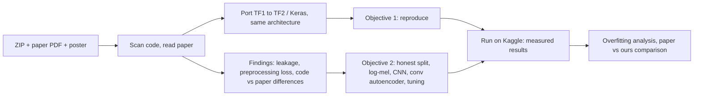

---

## 2. The paper in one page

**Problem.** Music “style” is hard to define, but **genre** correlates strongly with it. The authors want a numeric vector (an *embedding*) per audio clip that captures
genre, learned **directly from raw audio** with no hand-made features (no MFCCs), so it could later drive music *style transfer* (the way VGG features drive image style transfer).

**Data.** GTZAN: 1000 clips × 30 s, 10 genres. They keep 4 genres (classical, jazz, metal, pop) → 400 clips.

**Idea — Deep Softmax Autoencoder (DSAE).** Two learners share one 64-number code:

* an **autoencoder** (500 numbers → 64 → 500) so the code keeps information about the audio;
* a **softmax classifier** on the same 64-d code so the code also separates genres.

Joint loss = reconstruction error + classification error.

**Evaluation they used.** Accuracy, precision, recall, F1 on held-out data, plus 2-D PCA pictures of the 64-d code and the 4-d logits.
**Reported:** DSAE 94.9 % train / 64.1 % dev / 65.3 % test; baseline two-layer NN 52.0 / 38.1 / 36.4 %.

---

## 3. What was inside the ZIP (the scan)

I extracted and read every source file.

| Original file | What it does | Where it lives now |
|---|---|---|
| `convertData.py`, `process_data.py` | Convert GTZAN to `.wav`, build arrays | `data_paper.py` |
| `softmaxautoencoder.py` | **Final model**: autoencoder + classifier, joint loss, 200 epochs | `models_paper.build_dsae`, `scripts/01_*` |
| `encoder.py` | Vanilla (reconstruction-only) autoencoder, 400 epochs | `models_paper.build_vanilla_ae` |
| `softmax.py`, `tfsoftmax.py` | Two-layer baseline classifier | `models_paper.build_baseline_nn` |
| `test*.py` | Load saved weights, print accuracy, draw PCA | `evaluate.py`, plots in `scripts/01_*` |
| `songs_dev.csv`, `labels_dev.csv` | Saved evaluation data (**2000 rows**) | not needed; rebuilt from audio |
| `modelWeights/` | TF1 checkpoints (~900 MB) | **not used** (§5, step 3) |

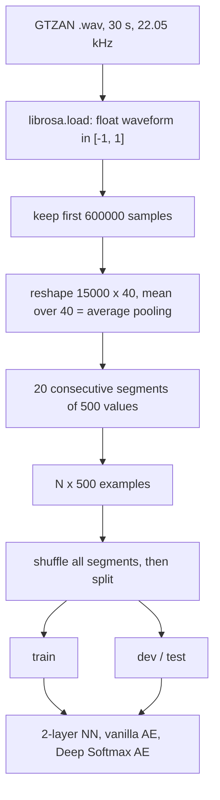

---

## 4. Findings from the scan, with reasons and measured evidence

| # | Finding | Why it matters | What I did | What the run showed |
|---|---|---|---|---|
| 1 | All segments are shuffled, *then* split; each song gives 20 segments, so the same song is in train and test. | Could inflate accuracy (“have I heard this song?”). | `--split random_segment` (reproduction) and `--split song` (honest). Leakage % is printed. | Leaky run printed **100.0 %**, song run **0.0 %**. **But accuracy barely changed: 61.2 % vs 60.1 % test.** The old model cannot exploit the leak (see §12.4). My earlier expectation of a clear drop was wrong. |
| 2 | Only a 2000-row dev file; no separate test in the code. | “Test” was effectively dev. | Scripts split 6000/1000/1000 as the paper states; improved pipeline uses train / val / test, tuning on **val only**. | – |
| 3 | Code loss = `MSE + 0.1·CE`; paper Eq. 3 says `γ·MSE + (1−γ)·CE`, γ = 0.9. | Different objectives. | Followed the **code** (`--cls-weight 0.1`). | Reproduction landed close to the paper (§10.1), supporting that choice. |
| 4 | Dropout keep-prob 0.8 in code, 0.9 in text. | Regularisation strength. | Followed code (Keras rate 0.2). | – |
| 5 | Decoder ends in ReLU though the waveform is in [−1, 1]. | Cannot reconstruct negative samples. | Kept for fidelity; `recon_activation="linear"` option; the new conv decoder uses a linear output. | – |
| 6 | Average pooling by 40: 22 050 Hz → 551.25 Hz. | Nyquist ≈ 275 Hz: nearly all timbre / harmonics removed; plain mean-pooling also aliases. | Motivated the log-mel input (Objective 2). | **Strong supporting evidence:** *metal* (whose character is loud, bright, distorted high-frequency content) was the **worst** class for the old model (F1 0.42) and the **best** for the new one (F1 ≈ 1.00). Consistent with the hypothesis; not a controlled proof (§12.5). |
| 7 | 20 of the 30 possible 500-sample slots per clip are used (≈ 18.1 s of audio; one segment = 20 000 raw samples ≈ 0.91 s). | Explains “one-second clips”. | Replicated. | – |
| 8 | Paper says 1000 tracks / 10 genres; only 4 genres × 100 clips are used. | Confusion. | Documented. | Real data: **399 songs** (one corrupt file skipped) → 7980 segments. |
| 9 | TF1 code (`tf.contrib`, `Session`, `sox`). | Not runnable on current Kaggle. | Ported to `tf.keras`. | Ran on Keras 3, Python 3.13. |

### The leakage picture

```
ORIGINAL (random segment split)                 THIS REPO (--split song)
-------------------------------                 ------------------------
song A: a1 a2 a3 a4 ... a20                     song A: a1 ... a20  ---> TRAIN (all 20)
          |  |  |  |                            song B: b1 ... b20  ---> TEST  (all 20)
          v  v  v  v                            song C: c1 ... c20  ---> VAL   (all 20)
        TRAIN TRAIN DEV TEST
Every song has pieces on both sides.            No song appears on two sides.
Test asks: "have I heard this song?"            Test asks: "can I label a NEW song?"
```

---

## 5. Overall plan — what I did, in order

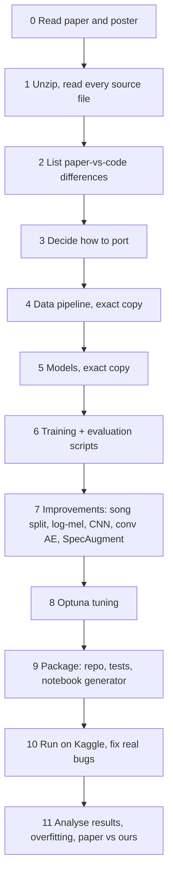

| Step | What | Why this choice |
|---|---|---|
| 0 | Read paper and poster. | Needed the stated claims to compare with the code. |
| 1 | Unzipped; read all `.py`, README, CSV shapes. | The code is the ground truth; the paper is a summary. |
| 2 | Compared paper vs code. | “Exactly” needs a decision on which to trust: **the code** (it produced the saved results). |
| 3 | Port to TF2/Keras rather than run the original or load its checkpoints. | TF1 is unavailable on current Kaggle; TF1 checkpoints only load into the same TF1 graph code; retraining small models takes minutes. |
| 4 | Re-implemented preprocessing line for line. | Any deviation changes the data distribution. |
| 5 | Re-implemented the three models: same sizes, activations, init, optimiser. | Same reason. |
| 6 | One script trains all three; produces Tables 1–2 and Figs 1, 3, 4, 5, 6. | Regenerate the paper’s outputs. |
| 7–8 | New input, models, tuning. | Objective 2. |
| 9 | Repo layout, offline tests, notebook **generated** from the repo files. | Guarantees notebook and repo never drift apart. |
| 10 | Ran on Kaggle; fixed three environment bugs (§14). | Real data exposes what offline tests cannot. |
| 11 | Computed train/val/test gaps, rebuilt learning curves from notebook logs, compared with the paper. | Verify the improvement is real, not an artefact. |

---

## 6. Objective 1 — exact reproduction, step by step

### 6.1 Data pipeline (`src/genre/data_paper.py`)


* **Method — average pooling:** replace each block of 40 consecutive samples by their mean; shrinks the input 40× and acts as a crude low-pass filter.
* **Why copied as is:** it is what the original models trained on.
* **Extra I added:** a `song` id per segment. Not used by the old models, but needed to measure leakage, split by song, and average predictions per song.
* **Defensive changes:** unreadable files are skipped with a warning (one GTZAN file is corrupt in the common Kaggle copy → **399 songs → 7980 segments**); short clips are zero-padded.
* **Labels:** classical 0, jazz 1, metal 2, pop 3 (same order and PCA colours as the original).
* **Cache:** arrays are saved to `.npz` so audio is read once; an empty or corrupt cache is ignored.

### 6.2 The three models (`src/genre/models_paper.py`)

Glorot-uniform init (= original Xavier) with zero biases; Adam, lr 1e-4, batch 512.

| Model | Architecture | Parameters | Epochs | Loss |
|---|---|---|---|---|
| Baseline NN | 500 → 128 tanh → 4 | **64 644** | 200 | cross-entropy |
| Vanilla AE | encoder + decoder below, no classifier | **421 556** | 400 | MSE |
| **Deep Softmax AE** | encoder + decoder + classifier | **424 232** | 200 | `1.0·MSE + 0.1·CE` |

```
                       ENCODER                                                         DECODER
 x(500) ─► 256 sigmoid ─► 192 tanh ─► Dropout .2 ─► 128 relu ─► z(64, relu) ─► 128 sigmoid ─► 192 sigmoid ─► Dropout .2 ─► 256 relu ─► x_hat(500, relu)
                                                                  │
                                                                  └─► 32 tanh ─► 16 tanh ─► 4 logits ─► softmax (genre)
```

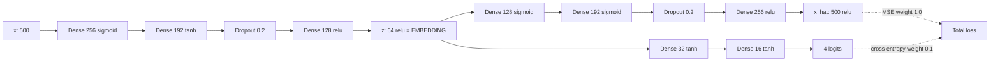

* **Authors’ reasoning (preserved):** the classifier sees 64 numbers instead of 500 (fewer weights to overfit); reconstruction forces the code to describe the *audio*, classification forces it to describe the *genre*.
* **Training mechanics copied:** data shuffled **once**, then `fit(shuffle=False)` (fixed minibatch order like the original).
* **Evaluation detail:** in my script, train/dev/test accuracy are all computed in inference mode (dropout off).

### 6.3 Outputs the script regenerates

| Paper item | File |
|---|---|
| Table 1 accuracies | printed + `metrics.json` |
| Table 2 precision / recall / F1 | printed + `metrics.json` |
| Fig. 1 PCA of raw 500-d data | `fig1_pca_raw.png` |
| Fig. 3 training curves | `fig3_dsae_curves.png` |
| Fig. 4 confusion matrix | `fig4_confusion_dsae_test.png` |
| Fig. 5 PCA of 64-d bottleneck (vanilla AE, DSAE) | `fig5a_…`, `fig5b_…` |
| Fig. 6 PCA of 4-d logits (NN, DSAE) | `fig6a_…`, `fig6b_…` |

---

## 7. Objective 2 — improvement, step by step

I changed things in a logical order: first fix how we **measure**, then what the model **sees**, then the model, then tune.


### A. Song-level split (`utils.song_split`, `make_splits`)

* **What:** split *songs* 70 / 15 / 15 into train / val / test, stratified by genre, then take all of a song’s segments with it.
  Real counts: **279 / 60 / 60 songs**; mel segments **5300 / 1139 / 1140**; paper-style segments 5580 / 1200 / 1200.
* **Why:** removes the §4-#1 leak; the only way a number means “works on unseen music”.
* **Optional:** `--folds 5 --fold k` — stratified 5-fold CV, because 60 test songs is noisy.

### B. Log-mel input (`data_mel.py`)

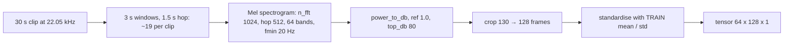

| Choice | Reason |
|---|---|
| Full 22.05 kHz bandwidth | Removes the 275 Hz ceiling. |
| Mel scale, 64 bands | Mimics pitch perception; compact (8192 values per window) yet keeps timbre. |
| Log (dB) scale | Loudness perception is logarithmic; tames dynamic range. |
| `ref=1.0`, not `ref=max` | Keeps absolute loudness, a genre cue. |
| 3 s windows, 50 % overlap | Long enough for rhythm and texture; ≈ 19 samples per song. Real total **7579** segments (two clips are slightly short and give 18). |
| Crop 130 → 128 frames | Power of two: four 2× poolings and four 2× upsamplings restore the exact shape. |
| **Train-only** standardisation | Val/test statistics would leak information. |
| Cached `.npz` | Feature extraction is the slow step. |

This is a fixed signal-processing transform feeding a learned model, **not** hand-engineered MFCC/tempo/pitch features; it still relaxes the paper’s “no feature engineering” stance, which the authors themselves list as future work.

### C. Mel-CNN (`models_improved.build_cnn`) — **592 228 parameters** (base 32, latent 64; computed by hand from the code, `model.summary()` is authoritative)

```
 input 64x128x1
   └► [Conv3x3 → BN → ReLU] ×2, 32  → MaxPool 2 → Dropout(0.15)     (32 x 64)
   └► [Conv3x3 → BN → ReLU] ×2, 64  → MaxPool 2 → Dropout(0.15)     (16 x 32)
   └► [Conv3x3 → BN → ReLU] ×2, 128 → MaxPool 2 → Dropout(0.15)     ( 8 x 16)
   └► [Conv3x3 → BN → ReLU] ×2, 128 → MaxPool 2 → Dropout(0.15)     ( 4 x  8)
   └► GlobalAveragePooling → Dense(64, ReLU) = EMBEDDING → Dropout(0.3) → Dense(4) logits
```

* **Why a CNN:** a spectrogram is a time × frequency image; convolutions share weights across time and pitch (fewer effective parameters, tolerance to shifts).
* **Why BatchNorm:** stabilises training, allows lr 1e-3.
* **Why global average pooling:** removes a huge flatten→dense layer, a classic source of overfitting.

### D. Conv Deep Softmax Autoencoder (`build_conv_dsae`) — **1 556 965 parameters** (default), 392 557 (tuned), same caveat

The paper’s idea (one shared code feeding a decoder and a classifier), made convolutional.

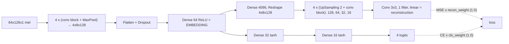

* **Classifier head 64→32→16→4 tanh:** identical to the paper, so only the front-end changed.
* **Linear reconstruction output:** inputs are standardised (negative values exist) — fixes §4-#5.
* **Why keep the reconstruction branch:** preserves the project’s goal (a reusable embedding for style transfer) and acts as a regulariser. Whether it raises accuracy is answered by `cnn` vs `conv_dsae`: **it did not** (97.0 % vs 96.7 %, one song apart).
* **Denoising:** with SpecAugment the *input* is masked and the *target* stays clean.

### E. Regularisation and training mechanics (`training.py`)

| Mechanism | What | Why |
|---|---|---|
| **SpecAugment** | One random frequency stripe (≤ 10 mel bins) and one time stripe (≤ 16 frames) zeroed per sample, new masks each epoch. | Cheap augmentation; forces redundant cues. |
| Dropout | In conv blocks and before logits. | Small dataset (279 training songs). |
| BatchNorm | After each conv. | Stabilisation; mild regularisation. |
| **Early stopping on validation accuracy** | `BestValAcc` callback keeps the best weights, stops after 12 stale epochs. | Keras metric names differ between versions 2 and 3, so I compute accuracy myself. |
| ReduceLROnPlateau | ×0.5 after 4 epochs without `val_loss` gain. | Fine convergence. |
| tf.data pipeline | Reshuffles every epoch; augmentation on the fly. | Different masks each epoch. |
| Fixed seeds | Python, NumPy, TF. | Reproducibility (GPU non-determinism remains). |

Training defaults: Adam lr 1e-3, batch 64, ≤ 60 epochs. Real runs stopped at **46 / 43 / 37 epochs** with best epochs **34 / 31 / 25**.

### F. Why not pretrained audio models?
PANNs / AST / MERT would very likely score higher but need internet for weights (off by default on Kaggle) and would no longer be “learn the embedding from our data”. They are the natural next step.

---

## 8. Evaluation and metrics (`evaluate.py`)

| Metric | Definition | Why |
|---|---|---|
| Segment accuracy | Share of segments labelled correctly. | Comparable with the paper. |
| **Song accuracy** | Average a song’s segment probabilities, take the arg-max. | What a user cares about; smooths random segment errors. |
| Precision / recall / F1 per class | scikit-learn definitions. | Paper’s Table 2; shows which genres are confused. |
| Macro-F1 | Mean F1 over classes. | One balanced number. |
| Normalised confusion matrix | Rows = true genre, rows sum to 1. | Paper’s Fig. 4. |
| PCA of embeddings | 2-D projection of the 64-d code. | Paper’s qualitative evidence; PCA keeps directions of largest variance, so unseparated clusters may still be separable in higher dimensions. |
| Leakage % | Test segments whose song is in train. | Makes §4-#1 visible on every run. |

Rule: **tune on validation; look at test once.**

---

## 9. Hyper-parameter tuning

### 9.1 Method (`scripts/03_tune_optuna.py`)

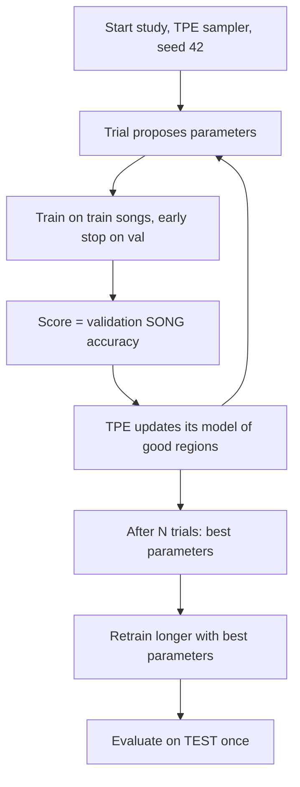

**TPE** (Tree-structured Parzen Estimator) models which parameter regions scored well and samples more there: more sample-efficient than grid search and handles mixed continuous/categorical spaces.

| Parameter | Range |
|---|---|
| learning rate | 3e-4 … 3e-3 (log) |
| base filters | {16, 32, 48} |
| latent size | {32, 64, 128} |
| dropout | 0.1 … 0.5 |
| batch size | {32, 64, 128} |
| SpecAugment | {on, off} |
| classification weight (conv DSAE) | 0.1 … 5 (log) |
| `paper_dsae` mode | lr, latent, dropout, cls weight, batch, decoder activation relu/linear |

Defaults: 20 trials × ≤ 30 epochs, patience 8; final retrain ≤ 80 epochs, patience 12. The search took **≈ 1.5 h** on the T4 (from log timestamps) — most of the “3 hours”.

### 9.2 Hygiene fix
In the first run the tuner also *printed* test scores for every trial. They were never used for selection, but to keep the rule clean, `train_eval(..., eval_test=False)` is now passed by the tuner so test data is not even computed during the search.

### 9.3 What tuning achieved — **nothing measurable**

| | Value |
|---|---|
| Trial validation song-accuracy | 0.90 … 1.00 over 20 trials (many at 0.95–0.98) |
| Best trial (validation) | 1.00 = 60/60 songs |
| Best parameters | lr 0.00197, base 16, latent 32, dropout 0.235, cls weight 4.0, batch 128, **SpecAugment off** |
| Test, retrain inside tuner | 95.8 % segments, 96.7 % songs |
| Test, retrain via script 02 | 95.4 % segments, 98.3 % songs |
| Untuned mel-CNN (for comparison) | **97.0 % segments, 98.3 % songs** |

Reading it: picking the best of 20 noisy scores gives an optimistic number (the *winner’s curse*): the validation set has 60 songs, so trials differ by single songs. The tuned model is **not better** than the default and its two retrains differ by a song from each other (run-to-run noise). It also switched SpecAugment off and overfit slightly more (§11).

---

## 10. All measured results

Single run, seed 42, 399 songs, 2 × T4. “Song acc” = average of segment probabilities per song.

### 10.1 Reproduction fidelity (paper approach, **our port**) — random-segment split, as in the paper

| | Paper | Ours |
|---|---|---|
| Two-layer NN train / dev / test | 52.0 / 38.1 / 36.4 % | 53.2 / 40.2 / 40.0 % |
| Deep Softmax AE train / dev / test | 94.9 / 64.1 / 65.3 % | 86.1 / 62.1 / 61.2 % |
| Per-class F1 (classical / jazz / metal / pop) | 0.779 / 0.616 / 0.534 / 0.638 | 0.782 / 0.578 / 0.467 / 0.613 |
| Precision / recall classical | 0.783 / 0.775 | 0.728 / 0.846 |

**Conclusion:** the port is faithful on dev/test and on the per-class pattern (classical easiest, metal hardest; classical F1 0.782 vs 0.779). Our training accuracy is lower (86 % vs 95 %); cause unknown (candidates: seed/split, unreported tweaks, our inference-mode accuracy).
Test size differs slightly (998 vs 1000 segments). A 3-epoch smoke test scored ≈ 22 % (chance 25 %), as expected.

### 10.2 Same models, honest split-by-song

| | Train | Dev | Test | Test song acc | Macro-F1 |
|---|---|---|---|---|---|
| Two-layer NN | 53.4 % | 40.3 % | 39.8 % | – | – |
| Deep Softmax AE | 86.5 % | 62.6 % | 60.1 % | 65.0 % (60 songs) | 0.598 |

Per-class F1 (test): classical 0.805, jazz 0.622, **metal 0.421**, pop 0.545.

### 10.3 Improved models (song split)

| Model | Val seg acc | Val song acc | **Test seg acc** | **Test song acc** | Test macro-F1 | Epochs (best) |
|---|---|---|---|---|---|---|
| **mel-CNN** | 96.6 % | 96.7 % | **97.0 %** | **98.3 %** | 0.970 | 46 (34) |
| Conv DSAE (default) | 96.7 % | 98.3 % | 96.7 % | 96.7 % | 0.967 | 43 (31) |
| Conv DSAE (tuned) | 94.9 % | 98.3 % | 95.4 % | 98.3 % | 0.954 | 37 (25) |

Per-class F1 on test, mel-CNN: classical 0.961, jazz 0.953, **metal 0.998**, pop 0.969.

### 10.4 How big is the uncertainty?
With 60 test songs, 95 % Wilson intervals are: 59/60 → **91.1–99.7 %**, 58/60 → **88.6–99.1 %**, 57/60 → 86.3–98.3 %. The 1140 segments are not independent (≈ 19 per song), so the effective sample is close to 60.
Therefore: **old vs new (≈ 60 % vs ≈ 97 %) is a real difference; mel-CNN vs conv DSAE vs tuned is not.**

---

## 11. Overfitting analysis

### 11.1 What overfitting is
The model memorises its training data (including noise) instead of the general pattern: very good on seen songs, clearly worse on unseen songs.
We detect it with (1) the gap between train and held-out accuracy / loss, (2) the shape of the learning curves, and (3) a held-out set that truly shares nothing with training.

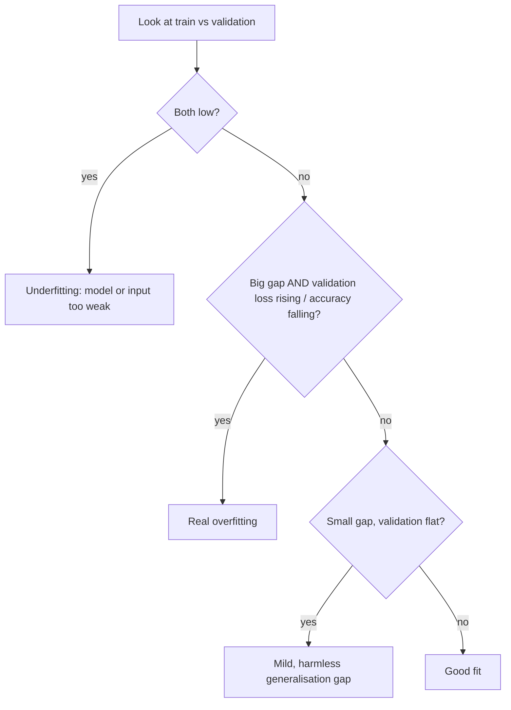

### 11.2 Train vs held-out numbers

| Model | Train acc | Val acc | Test acc | Train − test gap | Verdict |
|---|---|---|---|---|---|
| Two-layer NN (song split) | 53.4 % | 40.3 % | 39.8 % | 13.6 | Poor everywhere (underfits) |
| Deep Softmax AE, paper approach (song split) | 86.5 % | 62.6 % | 60.1 % | **26.4** | **Heavy overfitting** |
| Deep Softmax AE, paper approach (leaky) | 86.1 % | 62.1 % | 61.2 % | 24.9 | Heavy overfitting |
| Paper’s own numbers | 94.9 % | 64.1 % | 65.3 % | 29.6 | Heavy overfitting |
| **mel-CNN** | ≈ 99.9 % | 96.6 % | 97.0 % | **≈ 3** | **Mild** |
| **Conv DSAE** | ≈ 99.9 % | 96.7 % | 96.7 % | **≈ 3** | **Mild** |
| Conv DSAE tuned (SpecAugment off) | ≈ 100 % | 94.9 % | 95.4 % | ≈ 4.6 | Mild, slightly worse |

Note: for the mel models, train accuracy comes from the Keras epoch logs (dropout and augmentation **on**), so inference-mode training accuracy is a hair higher and the true gap is about 3–3.5 points.

### 11.3 Learning curves

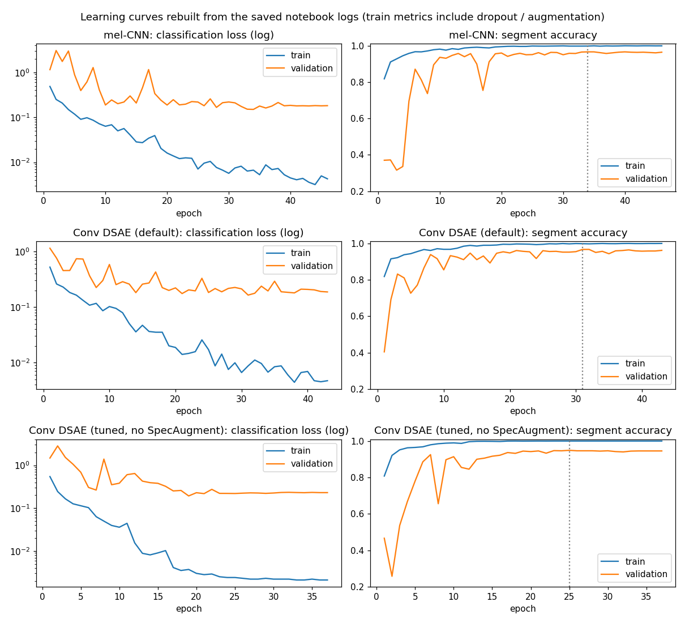

*The Kaggle session reset and deleted the original `curves.png` files, so this figure was rebuilt from the epoch logs saved in the notebook.*

**How to read it.** Rows: mel-CNN, conv DSAE (default), conv DSAE (tuned). Blue = training, orange = validation (unseen songs; the one that matters). X-axis = epochs.

* **Left graphs (loss, log scale — each gridline is 10× smaller):** blue keeps falling to ≈ 0.004; orange falls fast then flattens near 0.18. The vertical distance is the generalisation gap.
* **Right graphs (accuracy):** blue ≈ 1.0 from epoch ~10; orange ≈ 0.96. The dotted line marks the best validation epoch whose weights are kept.
* **First 5–8 epochs:** orange swings wildly (down to 0.3–0.4) while blue is already > 0.9. That is BatchNorm statistics catching up under a high learning rate, **not** overfitting.
* **Overfitting would look like:** orange loss climbing and orange accuracy dropping while blue improves. Not seen.

| Run | Epochs | Best val acc (epoch) | Min val loss (epoch) | Val loss, mean of last 10 epochs |
|---|---|---|---|---|
| mel-CNN | 46 | 96.6 % (34) | 0.150 (34) | 0.185 |
| Conv DSAE | 43 | 96.7 % (31) | 0.165 (31) | 0.204 |
| Conv DSAE tuned | 37 | 94.9 % (25) | 0.193 (19) | 0.229 |

Validation loss drifts up only slightly (0.150 → 0.185) after its minimum, and accuracy never drops → early stopping handles it.

### 11.4 Verdict
* **Paper approach: overfits heavily** (≈ 26–30 point gap, in both the leaky and honest split).
* **Ours: no meaningful overfitting.** A small gap (~3 points) remains: training loss 0.004 vs validation 0.18 means the model is far more confident on training songs, but accuracy on unseen songs is stable and high. This is mild and typical for a small dataset.
* **Internal evidence that regularisation works:** the tuned model, which switched SpecAugment off, has the largest gap and the lowest validation accuracy.
* **Test ≥ validation** for the default models (97.0 vs 96.6; 96.7 vs 96.7), so selecting the best epoch on validation did not make validation optimistic.

### 11.5 Why ours does not overfit (mechanisms)

| Reason | How it helps |
|---|---|
| **Informative input** (full-bandwidth log-mel) | The model can fit real genre structure instead of memorising noise from a degraded signal. |
| Convolutions, weight sharing | Same filters across time and pitch. |
| **Global average pooling** | No giant dense layer after the conv stack. |
| Dropout (0.15 in blocks, 0.3 before logits) | Prevents co-adaptation. |
| BatchNorm | Stabilises, mild regularisation. |
| **SpecAugment / denoising** | New masked variants each epoch. |
| **Early stopping + best-weight restore** | Stops at 34 / 31 / 25, not at the last epoch. |
| LR halving on plateau | Settles without bouncing. |
| ≈ 19 overlapping windows per song | 5300 training samples instead of 279. |
| Honest song-level split | Measures the real gap; nothing hidden by leakage. |

Parameter count is **not** the reason: the conv DSAE has ≈ 1.56 M parameters, nearly 4× the paper’s 0.42 M, yet generalises far better. What matters is the input information and the inductive bias.

### 11.6 Extra checks (code provided, **not yet run**)

1. **Shuffled-label test** — train on random genre labels (per song), evaluate on true validation labels. Must stay near **25 %**; much higher would reveal leakage.
2. **5-fold cross-validation** — every song tested once (~400 songs), tightening the interval.

```python
# 1) shuffled labels
import sys, numpy as np
R = "/kaggle/working/genre-extraction-repro"; sys.path.insert(0, f"{R}/src")
from genre.data_mel import prepare_mel
from genre.experiment import train_eval
from genre.utils import find_gtzan_root
data = prepare_mel(find_gtzan_root("auto"), cache=f"{R}/outputs/cache/mel64x128.npz", split="song")
X, y, s = data["train"]; songs = np.unique(s)
new = dict(zip(songs, np.random.RandomState(0).permutation([y[s == i][0] for i in songs])))
data["train"] = (X, np.array([new[i] for i in s], dtype=np.int32), s)
r = train_eval("cnn", dict(lr=1e-3, base=32, latent=64, dropout=0.3), data, epochs=25, batch=64, augment=True, patience=25)
print("val song acc with SHUFFLED labels:", r["val"]["song_acc"], "(chance = 0.25)")

# 2) 5-fold CV
for k in range(5):
    !cd {R} && python scripts/02_train_improved.py --model cnn --folds 5 --fold {k} --out outputs/cv_cnn_{k}
```

---

## 12. Paper vs ours: differences, and why ours is better

### 12.1 Side by side

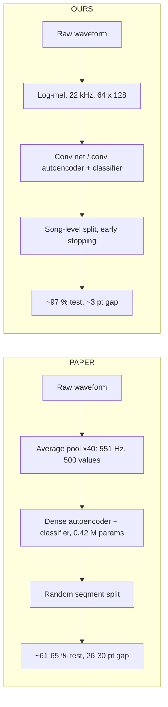

| Aspect | Paper | Ours |
|---|---|---|
| Input representation | 500 pooled waveform samples (551 Hz effective) | 64 × 128 log-mel spectrogram (full 22 kHz band) |
| Feature engineering | none | one fixed signal-processing transform (log-mel) |
| Window length | ≈ 0.91 s | 3 s, 50 % overlap |
| Samples per song | 20 | ≈ 19 |
| Model family | fully-connected | convolutional (CNN, conv autoencoder) |
| Parameters | 424 k | 592 k (CNN) · 1.56 M (conv DSAE) |
| Embedding | 64-d (and 4-d logits) | 64-d (CNN, conv DSAE) |
| Loss | `MSE + 0.1·CE` | CE (CNN); `1.0·MSE + 1.0·CE` (conv DSAE) |
| Decoder output | ReLU (cannot go negative) | linear |
| Regularisation | dropout 0.2 | dropout, BatchNorm, GAP, SpecAugment, early stopping, LR decay |
| Split | random segments (same song on both sides) | by song, stratified, train / val / test |
| Test set | effectively the dev set | separate 60-song test, tuned on val only |
| Metrics | segment accuracy, P/R/F1 | + per-song accuracy, macro-F1, leakage %, CIs |
| Tuning | manual | Optuna TPE (found no gain) |
| Framework | TensorFlow 1 | TensorFlow 2 / Keras 3 |
| Result | 65.3 % test, gap ≈ 30 pts | 97.0 % test (98.3 % per song), gap ≈ 3 pts |

### 12.2 How much better (same honest split, same 4 genres)

| | Old approach (our port) | New (mel-CNN) | Change |
|---|---|---|---|
| Test segment accuracy | 60.1 % | 97.0 % | **+36.9 pts** |
| Test song accuracy | 65.0 % | 98.3 % | +33.3 pts |
| Macro-F1 | 0.598 | 0.970 | +0.372 |
| Worst-class F1 | metal 0.421 | jazz 0.953 | +0.53 |
| Train − test gap | 26.4 pts | ≈ 3 pts | gap shrank ~9× |

The improvement is ≈ 37 points against a 60-song uncertainty of roughly ±5–9 points, so it is not noise.

### 12.3 What is *not* different
The core idea (a shared code feeding both a reconstruction decoder and a classifier), the 64-d bottleneck, the 64→32→16→4 tanh classifier head, the four genres, the PCA-based inspection, and the evaluation of precision / recall / F1 are all retained.

### 12.4 Why leakage did not matter for the old model
Random-segment split (100 % leak) gave 61.2 % test; song split (0 % leak) gave 60.1 %. A model can only exploit leakage if it can recognise individual songs; the 551 Hz input appears to carry too little song-specific detail for that. (An explanation, not tested.) Leakage still matters in principle — and for the new, higher-capacity models it could matter — so the song split is kept.

### 12.5 Is the comparison fair? Caveats
* It compares **systems**, not a single controlled change: input, window length, model family and regularisation all differ.
* Our input relaxes “no feature engineering”.
* Supporting evidence that the input matters most: *metal* flips from worst (F1 0.42) to best (F1 ≈ 1.00), which fits the loss of high-frequency information in the pooled signal.
* To isolate causes, run these ablations (not yet done):

| Ablation | Question it answers |
|---|---|
| Old MLP on flattened log-mel (e.g. 64 × 128 → dense) | Is the input alone enough? |
| CNN on the pooled 500-sample waveform (1-D conv) | Is the model alone enough? |
| mel-CNN without SpecAugment / without dropout | Which regulariser matters? |
| mel-CNN vs conv DSAE across 5 folds | Does reconstruction ever help? |

---

## 13. How to run

### Kaggle
1. Import `notebooks/kaggle_genre_extraction.ipynb`.
2. Add Data → *GTZAN Dataset - Music Genre Classification*. It mounts under `/kaggle/input/datasets/<owner>/<name>/Data/` and contains `genres_original` (**WAV audio, needed**) and `images_original` (PNG spectrograms, ignored; the loader requires `.wav`).
3. Accelerator → GPU. Run from the top. **If the session restarts, `/kaggle/working` is wiped: rerun setup and every `%%writefile` cell.**
4. Run the smoke test first. Expect `GTZAN root: …/Data/genres_original` and `[data] 399 songs → 7980 segments`.
5. **Before closing the session download `genre_outputs.zip` or use Save Version**, otherwise the outputs are lost.
6. You can skip the tuning cell (≈ 1.5 h) — it gave no gain.

### Local / GitHub
```bash
pip install -r requirements.txt
python tests/test_pipeline.py
python scripts/01_reproduce_paper.py --data-root <genres_original> --out outputs/paper_leaky
python scripts/01_reproduce_paper.py --data-root <genres_original> --out outputs/paper_song --split song
python scripts/02_train_improved.py  --model cnn       --out outputs/cnn
python scripts/02_train_improved.py  --model conv_dsae --out outputs/conv_dsae
python scripts/03_tune_optuna.py     --model conv_dsae --trials 20 --epochs 30 --out outputs/tune      # optional, ~1.5 h on a T4
python scripts/02_train_improved.py  --model conv_dsae --params outputs/tune/best_params.json --epochs 80 --out outputs/conv_dsae_tuned
```
`--quick` = 2–3 epoch smoke test. Features cache to `outputs/cache/`.

### Demo for a reviewer (`scripts/04_demo.py`, takes seconds)

```bash
python scripts/04_demo.py --weights outputs/cnn/cnn.weights.h5 --n 12                      # verify + show songs
python scripts/04_demo.py --weights outputs/cnn/cnn.weights.h5 --n 0 --audio my_song.wav   # your own clip
```
It (1) rebuilds the exact song split and normalisation, (2) loads the trained weights and **re-computes** accuracy on the 60 unseen test songs, printing it next to the value saved in `metrics.json` (they must match),
(3) lists random test songs with true genre, predicted genre and confidence, and (4) classifies any audio file you pass, saving a spectrogram + probability chart.
Suggested order for a presentation: problem → paper’s approach and its weakness → our changes → learning curves (§11.3) → run the demo → limitations (§15).
**Prepare before the session:** Kaggle wipes `/kaggle/working` when a session ends, so save `cnn.weights.h5` and `outputs/cache/mel64x128.npz` (Save Version, or Output → New Dataset) and rehearse once.
Use `.wav` for your own clips (mp3 depends on the system codecs). The demo script was logic-tested offline with a stub model; it has not yet run against real weights.

### Layout
```
src/genre/   config · utils · data_paper · data_mel · models_paper · models_improved · training · experiment · evaluate
scripts/     01_reproduce_paper · 02_train_improved · 03_tune_optuna · 04_demo
tests/       test_pipeline.py          (librosa stubbed; shapes, split disjointness, leakage, metrics)
tools/       build_kaggle_notebook.py  (regenerates the notebook from the files above)
notebooks/   kaggle_genre_extraction.ipynb
docs/        learning_curves_from_log.png
```

---

## 14. Development log: what broke and why

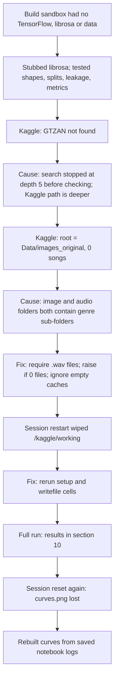

| # | Symptom | Cause | Fix |
|---|---|---|---|
| 1 | `GTZAN not found` though attached | directory pruned at depth 5 before testing | test first, no depth limit, skip `outputs/` |
| 2 | `…/images_original`, `0 songs`, `zero-size array`, `Invalid input shape (512,)` | name-only check matched the PNG folder | require `.wav` in every genre folder; raise when nothing is read; ignore empty caches |
| 3 | `No such file … utils.py` | session restart wiped working dir | rerun setup + `%%writefile` |
| 4 | tuner printed test scores per trial | `train_eval` always evaluated test | `eval_test=False` in the tuner |
| 5 | `curves.png` not found | session reset again | rebuild from notebook logs (`docs/`) |

Environment seen: Python 3.13, **Keras 3**, 2 × Tesla T4 (TensorFlow uses the first GPU only; fine for these models). The full pipeline run took about 3 h, ≈ 1.5 h of it tuning.

---

## 15. Limitations and risks

* **60 test songs**: ± several points; do 5-fold CV before any final claim.
* **GTZAN is a flawed benchmark** (reported duplicates, mislabels, shared artists). A song split removes segment leakage, not same-artist or duplicate-track effects, so ≈ 97 % may be somewhat optimistic.
* **Four easy genres** (classical, jazz, metal, pop); the 10-genre problem is harder.
* **Shuffled-label test and CV not yet run.**
* **Not a controlled ablation**: input, model and regularisation changed together (§12.5).
* **Relaxed “no feature engineering”** (log-mel).
* Reproduction training accuracy (86 %) is lower than the paper’s (95 %); cause unknown.
* Loss weights and dropout follow the code, not the paper.
* Single run, single seed; GPU non-determinism possible.
* Two GPUs not exploited. Parameter counts for conv models computed by hand from the code.

---

## 16. Questions a reviewer may ask

**Did your model overfit?** No meaningful overfitting: ≈ 99.9 % on training vs ≈ 97 % on unseen test songs (gap ≈ 3 pts), validation accuracy stayed stable instead of falling, the best epoch is restored, and no song is shared between train and test (0.0 % leakage). The paper-style model did overfit heavily (86.5 % vs 60.1 %).

**How do you know?** Train-vs-test gaps (§11.2), learning curves (§11.3), early stopping at epochs 34/31/25, 0 % leakage, and a tuned run with SpecAugment off that overfit more.

**Why is 97 % believable?** Held-out songs, per-class F1 all ≥ 0.95, consistent val/test. Honest limits: 60 songs (interval ≈ 89–99 %), GTZAN flaws, and the pending shuffled-label and 5-fold checks.

**Why split by song?** Segments of one song are near-duplicates; a segment split can make the test measure memory instead of generalisation. (For the old model it made little difference — §12.4.)

**Why mel spectrograms?** The pooled waveform keeps only < 275 Hz. Log-mel keeps the full band at perceptual resolution. Supporting evidence: *metal* went from worst to best.

**Is the improvement just the input, or the model?** Not isolated yet; §12.5 lists the ablations.

**Did tuning help?** No (§9.3): the tuned model scored 95.4 % vs 97.0 % untuned; validation 100 % was a winner’s-curse artefact.

**Does the reconstruction branch help accuracy?** No difference at this sample size (97.0 % vs 96.7 %). Its value is the reusable embedding, not accuracy.

**What differs from the paper?** §12.1.

**What is the embedding for?** A 64-number genre-aware summary of a clip, for visualisation or later style transfer.

---

## 17. Glossary

| Term | Meaning |
|---|---|
| **Overfitting** | Model memorises training data; great on seen examples, worse on new ones. |
| **Underfitting** | Model too weak or input too poor; bad on both. |
| **Generalisation gap** | Train accuracy minus held-out accuracy. |
| **Embedding / latent code** | Short vector summarising an input (64 or 4 numbers). |
| **Autoencoder** | Compresses input to a small code and reconstructs it. |
| **Denoising autoencoder** | Input is corrupted (masked); target is the clean input. |
| **MSE** | Mean squared error between input and reconstruction. |
| **Softmax / cross-entropy / logits** | Scores → probabilities / penalty for low probability on the true class / the raw scores. |
| **Average pooling** | Replace a block of values by their mean. |
| **Nyquist limit** | Highest frequency a sampling rate can represent (half the rate). |
| **Spectrogram / mel / log-mel** | Time × frequency picture; perceptual frequency scale; decibel scaling. |
| **MFCC** | Compact hand-designed summary of a mel spectrogram (not used). |
| **CNN / convolution** | Network layer sliding small shared filters over an image. |
| **BatchNorm** | Normalises activations per batch; stabilises training. |
| **Global average pooling** | Averages each feature map to one number. |
| **Dropout** | Randomly disables units while training. |
| **SpecAugment** | Masking random frequency/time stripes as augmentation. |
| **Early stopping** | Stop when validation stops improving; keep the best weights. |
| **PCA** | Linear projection onto directions of greatest variance for 2-D plots. |
| **Data leakage** | Evaluation information influencing training (same song on both sides). |
| **TPE / Optuna** | Bayesian-style hyper-parameter search algorithm / library. |
| **Winner’s curse** | The best of many noisy scores is optimistically biased. |
| **Wilson interval** | Confidence interval for a proportion such as accuracy. |
| **Precision / recall / F1** | Of predicted X how many right / of true X how many found / their harmonic mean. |
| **Cross-validation** | Rotate which part of the data is held out so every song is tested once. |

---

# Appendices — deep dive (A–Q)

These appendices add detail to the sections above; nothing above was changed. Items marked **[measured]** come from the Kaggle run, **[calculated]** from the code or arithmetic, **[reasoned]** are design arguments that were *not* tested experimentally.

| | Appendix |
|---|---|
| A | Code map: every file, function and flag |
| B | Data shapes and sizes through both pipelines |
| C | Audio signal processing in detail (what the old and new inputs really contain) |
| D | Layer-by-layer architectures (shapes and parameters) |
| E | The mathematics: losses, optimiser, normalisation, metrics |
| F | A training run, step by step |
| G | Complete configuration of every run |
| H | Complete per-class results and error analysis |
| I | Tuning in full: all 20 trials |
| J | Compute, timing, environment, reproducibility |
| K | Decision log: alternatives considered |
| L | Tests: what is and is not verified |
| M | Troubleshooting guide |
| N | Statistical notes: how much can 60 songs tell us |
| O | Roadmap |
| P | Extra glossary |
| Q | Notebook walkthrough: what every section prints and how to read it |

---

## A. Code map: every file, function and flag

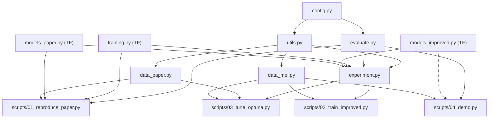

### A.1 `src/genre/`

| File | Function / constant | What it does | Notes |
|---|---|---|---|
| `config.py` | `GENRES`, `SEED`, `GENRE_COLORS` | Class order (classical 0, jazz 1, metal 2, pop 3), default seed 42, PCA colours (navy, green, darkorange, purple) | Same order and colours as the original plots |
| `utils.py` | `set_seed(seed)` | Seeds Python, NumPy and (if installed) TensorFlow | GPU kernels can still be non-deterministic |
| | `find_gtzan_root(explicit, genres)` | Walks `/kaggle/input`, `./genres`, `./data`, `.`; returns the first folder in which **every** genre sub-folder exists **and holds a `.wav`**; skips `outputs/` | Fix for bugs #1 and #2 (§14) |
| | `list_wavs(root, genre)` | Sorted list of `.wav` paths | Sorted → reproducible song ids |
| | `song_split(song_genre, val_frac, test_frac, seed, n_folds, fold)` | Stratified train/val/test split of **songs**; optional stratified K-fold | Returns sorted song indices |
| | `make_splits(X, y, song, mode, seed, n_folds, fold)` | `mode="random_segment"`: 75/12.5/12.5 random split of segments (original, leaky). `mode="song"`: song-level split, then all segments of each song | Returns `{"train","val","test"} → (X, y, song)` |
| | `leakage(splits)` | Share of test segments whose song also appears in train | Printed on every run |
| `data_paper.py` | `N_SAMPLES=600000, POOL=40, SEG_LEN=500, N_SEG=20` | Constants of the original pre-processing | |
| | `load_paper_dataset(root, genres, cache)` | Audio → pooled waveform → 20 segments per song; skips unreadable files; zero-pads short clips; raises if nothing could be read; caches to `.npz` (an empty cache is ignored) | Returns `X, y, song, names` |
| | `prepare_paper(root, cache, split, seed, n_folds, fold)` | Load + split + print leakage | No standardisation (as original) |
| `data_mel.py` | `SR=22050, SEG_SEC=3.0, HOP_SEC=1.5, N_FFT=1024, HOP=512, N_MELS=64, N_FRAMES=128` | Constants of the new input | |
| | `song_to_segments(path, librosa)` | One song → list of (64, 128) log-mel windows | `duration=30.0` cap; last window zero-padded |
| | `load_mel_dataset(root, genres, cache)` | All songs; same skipping / caching rules | |
| | `prepare_mel(root, cache, split, seed, n_folds, fold)` | Load, split by song, standardise with **train-only** mean/std, add channel axis | Returns tensors `(N, 64, 128, 1)` |
| `models_paper.py` | `_encode`, `_decode` | Shared encoder / decoder stacks (§6.2) | Layer names `enc1…`, `embedding`, `dec1…`, `recon` |
| | `build_baseline_nn(input_dim, n_classes, lr, hidden)` | 500→128 tanh→4 | Output layer named `logits` |
| | `build_vanilla_ae(input_dim, latent, dropout, lr, recon_activation)` | Autoencoder, MSE | |
| | `build_dsae(input_dim, latent, n_classes, dropout, lr, recon_weight, cls_weight, recon_activation)` | Deep Softmax Autoencoder; **dict outputs** `{"recon", "logits"}` | Dict outputs avoid Keras-2/3 output-structure mismatches |
| `models_improved.py` | `_conv_block(x, f)` | Conv3×3 (no bias) → BN → ReLU, twice | |
| | `build_cnn(input_shape, n_classes, base, latent, dropout, lr)` | Mel-CNN classifier, `embedding` layer, `logits` output | Accepts and ignores extra kwargs |
| | `build_conv_dsae(input_shape, n_classes, base, latent, dropout, lr, recon_weight, cls_weight)` | Conv autoencoder + classifier on the shared code | Dict outputs |
| `training.py` | `predict_logits(model, X, bs)` | Returns logits whatever the output structure (dict / list / array) | |
| | `spec_augment(x, max_f=10, max_t=16)` | One frequency mask + one time mask (zeros) | Per-sample, new every epoch |
| | `make_dataset(X, y, batch, augment, ae, shuffle)` | `tf.data` pipeline; for autoencoders targets are `{"recon": clean x, "logits": y}` | Input is masked, target is clean → denoising |
| | `BestValAcc(Xva, yva, patience)` | Callback: validation accuracy each epoch, keeps best weights, early-stops, restores best | Computes accuracy itself because Keras metric names differ between versions |
| | `fit_model(...)` | Wires dataset, `BestValAcc`, `ReduceLROnPlateau(val_loss, ×0.5, patience 4, min 1e-6)`; returns history + best val accuracy | History gets an extra `val_seg_acc` list |
| `experiment.py` | `build_model(kind, params, input_shape)` | `kind ∈ {cnn, conv_dsae, paper_dsae, paper_nn}` | |
| | `train_eval(kind, params, data, epochs, batch, augment, patience, seed, verbose, eval_test)` | Train → evaluate val (always) and test (only if `eval_test`) | Tuner passes `eval_test=False` |
| | `embeddings(model, X)` | Output of layer `embedding` (or the logits if the model has none) | Used for PCA plots |
| `evaluate.py` | `softmax`, `song_level` | Probabilities; mean of a song’s segment probabilities → one prediction | |
| | `summarize(logits, y, song, genres, name)` | Segment accuracy, macro-F1, song accuracy, per-class P/R/F1; prints the sklearn report | |
| | `plot_confusion`, `plot_pca`, `plot_history`, `save_json` | Figures and JSON output (Agg backend) | |

### A.2 Scripts and command-line flags

| Script | Flags (default) |
|---|---|
| `01_reproduce_paper.py` | `--data-root auto`, `--out outputs/paper`, `--split {random_segment, song}` (random_segment), `--epochs 200`, `--ae-epochs 400`, `--batch 512`, `--cls-weight 0.1`, `--seed 42`, `--quick` (3 epochs) |
| `02_train_improved.py` | `--model {cnn, conv_dsae}`, `--data-root auto`, `--out outputs/improved`, `--epochs 60`, `--batch 64`, `--lr 1e-3`, `--base 32`, `--latent 64`, `--dropout 0.3`, `--cls-weight 1.0`, `--recon-weight 1.0`, `--no-augment`, `--patience 12`, `--folds 0`, `--fold 0`, `--params best_params.json`, `--seed 42`, `--quick` (2 epochs) |
| `03_tune_optuna.py` | `--model {cnn, conv_dsae, paper_dsae}`, `--data-root auto`, `--out outputs/tune`, `--trials 20`, `--epochs 30`, `--final-epochs 80`, `--patience 8`, `--seed 42` |
| `04_demo.py` | `--weights outputs/cnn/cnn.weights.h5`, `--data-root auto`, `--cache outputs/cache/mel64x128.npz`, `--audio file…`, `--n 10`, `--out outputs/demo`, `--seed 42` |

### A.3 What each script writes

| Script | Output files |
|---|---|
| 01 | `metrics.json`, `fig1_pca_raw.png`, `fig3_dsae_curves.png`, `fig4_confusion_dsae_test.png`, `fig5a_pca_vanilla_ae.png`, `fig5b_pca_dsae_64.png`, `fig6a_pca_nn_logits.png`, `fig6b_pca_dsae_logits.png` |
| 02 | `metrics.json` (params, batch, SpecAugment flag, val and test results), `confusion_test.png`, `pca_embedding_test.png`, `curves.png`, `<model>.weights.h5` |
| 03 | `best_params.json`, `trials.csv`, `final_metrics.json` |
| 04 | `outputs/demo/demo_<name>.png` per audio file |
| all | features cached under `outputs/cache/` (`paper_500d.npz`, `mel64x128.npz`) |

---

## B. Data shapes and sizes through both pipelines

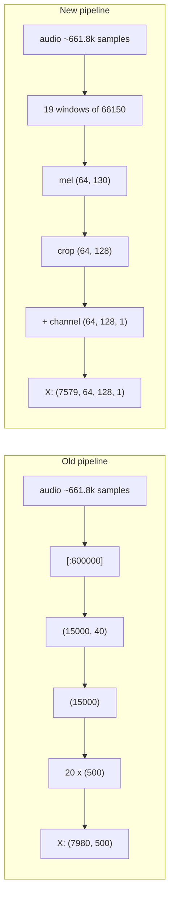

| Quantity | Old | New |
|---|---|---|
| Songs used | 399 (one unreadable file skipped) **[measured]** | 399 **[measured]** |
| Samples per song | 20 | ≈ 19 (two clips give 18) **[measured: 7579 = 399×19 − 2]** |
| Total segments | 7980 **[measured]** | 7579 **[measured]** |
| Values per sample | 500 | 8192 (64 × 128) |
| Audio covered per sample | ≈ 0.91 s | 3 s (1.5 s overlap) |
| Dataset in memory (float32) | ≈ 16 MB **[calculated]** | ≈ 248 MB **[calculated]** |
| Train / val / test (songs) | 279 / 60 / 60 (song split) | 279 / 60 / 60 |
| Train / val / test (segments) | 5580 / 1200 / 1200 (song split); 5985 / 997 / 998 (random split) | 5300 / 1139 / 1140 **[measured]** |

Old-pipeline segment counts for the random split follow `int(0.75·7980) = 5985`, then 997 and 998 **[calculated]**; the logged test support of 998 matches.

---

## C. Audio signal processing in detail

### C.1 What the old input really contains

Average-pooling 40 samples is a moving-average (boxcar) filter followed by keeping every 40th sample:

```
effective sampling rate  = 22 050 / 40            = 551.25 Hz
Nyquist frequency        = 551.25 / 2             ≈ 275.6 Hz
boxcar −3 dB point       ≈ 0.443 · 22 050 / 40    ≈ 244 Hz      (approximation for a 40-point moving average)
first null of the filter = 22 050 / 40            = 551.25 Hz
first side-lobe level    ≈ −13 dB                               (standard for a rectangular window)
```

Consequences **[reasoned]**: everything above ≈ 250 Hz is strongly attenuated; content that is not removed leaks (aliases) back into 0–275 Hz at roughly −13 dB or worse. The old model therefore mostly sees bass, low fundamentals and the slow amplitude envelope (rhythm and loudness contour), but almost none of the harmonics, bright cymbals or distortion that make timbre. This agrees with *metal* (distortion-heavy, bright) being the worst class for the old model **[measured: F1 0.42]**.

### C.2 What the new input contains

```
sample rate               22 050 Hz         → Nyquist 11 025 Hz (full band kept)
window (n_fft)            1024 samples      = 46.4 ms
hop                       512 samples       = 23.2 ms per frame
FFT bin spacing           22 050 / 1024     ≈ 21.5 Hz
frames per 3 s window     1 + 66 150 // 512 = 130   (centre-padded STFT) → cropped to 128 (≈ 2.97 s)
mel bands                 64, from 20 Hz to 11 025 Hz
values per window         64 × 128 = 8192
```

Steps per window:
1. `melspectrogram`: |STFT|² (power), projected onto 64 triangular mel filters.
2. `power_to_db(ref=1.0, top_db=80)`: `10·log10(max(S, 1e-10))`, then clipped to at most 80 dB below that window’s maximum.
3. Crop frames 130 → 128.
4. Standardise: `(x − μ_train) / σ_train` with **one scalar** mean and std computed on the training segments only.

Why `ref=1.0`: dB values are absolute, so overall loudness survives. Why one scalar (not per-band) standardisation **[reasoned]**: per-band normalisation would erase the average spectral tilt (bright vs dark sound), which is itself a genre cue.

---

## D. Layer-by-layer architectures

### D.1 Paper Deep Softmax Autoencoder (424 232 parameters **[calculated]**)

| Layer | Output shape | Parameters |
|---|---|---|
| Input | 500 | 0 |
| `enc1` Dense, sigmoid | 256 | 128 256 |
| `enc2` Dense, tanh | 192 | 49 344 |
| Dropout 0.2 | 192 | 0 |
| `enc3` Dense, ReLU | 128 | 24 704 |
| `embedding` Dense, ReLU | **64** | 8 256 |
| `dec1` Dense, sigmoid | 128 | 8 320 |
| `dec2` Dense, sigmoid | 192 | 24 768 |
| Dropout 0.2 | 192 | 0 |
| `dec3` Dense, ReLU | 256 | 49 408 |
| `recon` Dense, ReLU | 500 | 128 500 |
| `cls1` Dense, tanh (from embedding) | 32 | 2 080 |
| `cls2` Dense, tanh | 16 | 528 |
| `logits` Dense | 4 | 68 |
| **Total** | | **424 232** |

Vanilla AE = everything except `cls*` and `logits` = 421 556. Baseline NN = 500×128+128 + 128×4+4 = 64 644.

### D.2 Mel-CNN (592 228 parameters **[calculated]**, base 32, latent 64)

| Stage | Output shape | Parameters |
|---|---|---|
| Input | 64 × 128 × 1 | 0 |
| Block 1: 2 × (Conv3×3 → BN → ReLU), 32 filters | 64 × 128 × 32 | 9 760 |
| MaxPool 2, Dropout 0.15 | 32 × 64 × 32 | 0 |
| Block 2, 64 filters | 32 × 64 × 64 | 55 808 |
| MaxPool 2, Dropout 0.15 | 16 × 32 × 64 | 0 |
| Block 3, 128 filters | 16 × 32 × 128 | 222 208 |
| MaxPool 2, Dropout 0.15 | 8 × 16 × 128 | 0 |
| Block 4, 128 filters | 8 × 16 × 128 | 295 936 |
| MaxPool 2, Dropout 0.15 | 4 × 8 × 128 | 0 |
| Global average pooling | 128 | 0 |
| `embedding` Dense 64, ReLU | **64** | 8 256 |
| Dropout 0.3 | 64 | 0 |
| `logits` Dense 4 | 4 | 260 |
| **Total** (incl. BN moving statistics) | | **592 228** |

Convolutions have no bias (BatchNorm supplies the shift); each BN layer carries 4·f parameters (γ, β trainable; moving mean and variance not).

### D.3 Conv Deep Softmax Autoencoder (1 556 965 parameters **[calculated]**)

| Stage | Output shape | Parameters |
|---|---|---|
| Encoder: the same four conv blocks and poolings (no dropout between) | 4 × 8 × 128 | 583 712 |
| Flatten, Dropout 0.3 | 4096 | 0 |
| `embedding` Dense 64, ReLU | **64** | 262 208 |
| Classifier: Dense 32 tanh → Dense 16 tanh → `logits` 4 | 4 | 2 080 + 528 + 68 = 2 676 |
| Decoder Dense 4096, ReLU → Reshape | 4 × 8 × 128 | 266 240 |
| UpSampling ×2 → block, 128 filters | 8 × 16 × 128 | 295 936 |
| UpSampling ×2 → block, 64 filters | 16 × 32 × 64 | 111 104 |
| UpSampling ×2 → block, 32 filters | 32 × 64 × 32 | 27 904 |
| UpSampling ×2 → block, 16 filters | 64 × 128 × 16 | 7 040 |
| `recon` Conv3×3, 1 filter, linear | 64 × 128 × 1 | 145 |
| **Total** | | **1 556 965** (encoder 845 920 + classifier 2 676 + decoder 708 369) |

The tuned variant (base 16, latent 32) has 392 557 parameters **[calculated]** — about a quarter of the default. `model.summary()` is authoritative if a number ever disagrees.

**Why Flatten (not global pooling) in the autoencoder [reasoned]:** the decoder must rebuild where things happen in time and frequency; global pooling would discard that layout.

---

## E. The mathematics

All formulas in plain text.

```
Softmax                p_i = exp(z_i) / Σ_j exp(z_j)                (z = 4 logits)
Cross-entropy (CE)     L_cls = −log p_true                          (averaged over the batch; computed from logits for stability)
MSE reconstruction     L_rec = mean over batch and all inputs of (x − x_hat)²
Paper DSAE loss        L = 1.0 · L_rec + 0.1 · L_cls                (from the code; Eq. 3 of the paper differs, see §4 #3)
Conv DSAE loss         L = w_rec · L_rec + w_cls · L_cls            (defaults 1.0 and 1.0; tuned: 1.0 and 4.0)
```

**Adam** (Keras defaults β1 = 0.9, β2 = 0.999, ε = 1e-7):
```
m ← β1·m + (1−β1)·g        v ← β2·v + (1−β2)·g²
θ ← θ − lr · m̂ / (√v̂ + ε)        (m̂, v̂ are bias-corrected)
```
**BatchNorm** (training): `y = γ·(x − μ_batch)/√(σ²_batch + ε) + β`; at inference the stored moving averages replace the batch statistics. The warm-up swings of validation accuracy in the first epochs (§11.3) are the moving averages catching up.
**Dropout:** during training each unit is zeroed with probability *p* and the rest scaled by 1/(1−p); disabled at inference.
**Initialisation:** Glorot-uniform, `limit = √(6 / (fan_in + fan_out))`, zero biases.
**ReduceLROnPlateau:** if `val_loss` has not improved for 4 epochs, `lr ← 0.5 · lr` (minimum 1e-6).
**Early stopping (`BestValAcc`):** after every epoch compute validation segment accuracy in inference mode; if strictly better than the best so far, store a copy of the weights and reset the counter; otherwise increment; stop when the counter reaches *patience*; at the end restore the stored weights.

**Metrics**
```
precision_c = TP_c / (TP_c + FP_c)       recall_c = TP_c / (TP_c + FN_c)       F1_c = 2·P·R / (P + R)
macro-F1    = mean of F1_c over the 4 classes
song prediction:  p̄ = (1/K) · Σ_k p_k   over the K segment probability vectors of a song;  ŷ = argmax p̄
Wilson 95 % interval for a proportion p̂ = k/n  (z = 1.96):
    centre = (p̂ + z²/2n) / (1 + z²/n)
    half   = z · √( p̂(1−p̂)/n + z²/4n² ) / (1 + z²/n)
```

---

## F. A training run, step by step

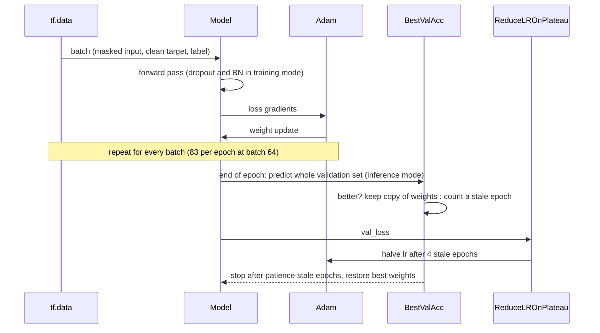

1. `clear_session()` and `set_seed(42)`.
2. Build the model (`build_model`).
3. Build the `tf.data` pipeline: shuffle (buffer = min(N, 20000), reshuffled every epoch) → per-sample SpecAugment (only if enabled and the data is 4-D) → batch → prefetch. For autoencoders the label dict is `{"recon": clean x, "logits": y}`.
4. `model.fit(ds, validation_data, epochs, callbacks=[BestValAcc, ReduceLROnPlateau])`.
5. Per epoch Keras logs train loss/accuracy (**with dropout and masks on**) and validation loss/accuracy (inference mode).
6. At the end the best-validation-accuracy weights are restored (epochs 34 / 31 / 25 in the real runs).
7. `summarize` prints validation metrics; test metrics only if `eval_test=True`; embeddings for PCA come from layer `embedding`.

**Reproduction pipeline (script 01) differs deliberately:** no validation-based early stopping, fixed epochs (200 / 400 / 200), data shuffled once and `shuffle=False`, as in the original.

**Epoch timing [measured]:** the first epoch is slow (46 s CNN, 82 s conv DSAE, 63 s tuned **[measured]**) because of graph tracing and cuDNN autotuning; later epochs are 5 s, 8 s and 4 s (median).

---

## G. Complete configuration of every run

| Run | Model / params | Optimiser | lr | Batch | Epoch cap (actual) | Patience | SpecAugment | Dropout | Loss weights (rec, cls) |
|---|---|---|---|---|---|---|---|---|---|
| Paper NN | 500→128→4 (64 644) | Adam | 1e-4 | 512 | 200 | – | – | – | CE only |
| Paper vanilla AE | 421 556 | Adam | 1e-4 | 512 | 400 | – | – | 0.2 | MSE only |
| Paper DSAE | 424 232 | Adam | 1e-4 | 512 | 200 | – | – | 0.2 | 1.0, 0.1 |
| mel-CNN | base 32, latent 64 (592 228) | Adam | 1e-3 | 64 | 60 (**46**) | 12 | on | 0.3 / 0.15 | CE only |
| Conv DSAE | base 32, latent 64 (1 556 965) | Adam | 1e-3 | 64 | 60 (**43**) | 12 | on | 0.3 | 1.0, 1.0 |
| Conv DSAE tuned | base 16, latent 32 (392 557) | Adam | 1.97e-3 | 128 | 80 (**37**) | 12 | **off** | 0.235 | 1.0, 4.0 |
| Tuner trials | search space (§9.1) | Adam | sampled | sampled | 30 | 8 | sampled | sampled | sampled |

Common to all: seed 42; Glorot-uniform initialisation; ReduceLROnPlateau (×0.5, patience 4, min 1e-6) in the improved runs only; song split 70/15/15 (279/60/60 songs) except the explicit `random_segment` run.

---

## H. Complete per-class results and error analysis

P = precision, R = recall, F1; support = number of segments. All **[measured]**.

### H.1 Paper approach (our port)

| Run | Class | P | R | F1 | Support |
|---|---|---|---|---|---|
| random split, test | classical | 0.728 | 0.846 | 0.782 | 240 |
| | jazz | 0.589 | 0.568 | 0.578 | 250 |
| | metal | 0.494 | 0.443 | 0.467 | 262 |
| | pop | 0.617 | 0.610 | 0.613 | 246 |
| | macro-F1 0.610, accuracy 0.612, per-song 0.677 (362 songs, leaky) | | | | |
| song split, test | classical | 0.785 | 0.827 | 0.805 | 300 |
| | jazz | 0.611 | 0.633 | 0.622 | 300 |
| | metal | 0.429 | 0.413 | 0.421 | 300 |
| | pop | 0.560 | 0.530 | 0.545 | 300 |
| | macro-F1 0.598, accuracy 0.601, per-song 0.650 (60 songs) | | | | |

### H.2 Improved models (song split)

| Model, set | Class | P | R | F1 |
|---|---|---|---|---|
| mel-CNN, val | classical | 0.960 | 0.940 | 0.950 |
| | jazz | 0.939 | 0.965 | 0.952 |
| | metal | 0.997 | 1.000 | 0.998 |
| | pop | 0.968 | 0.958 | 0.963 |
| **mel-CNN, test** | classical | 0.975 | 0.947 | 0.961 |
| | jazz | 0.948 | 0.958 | 0.953 |
| | metal | 1.000 | 0.996 | 0.998 |
| | pop | 0.959 | 0.979 | 0.969 |
| Conv DSAE, val | classical | 0.960 | 0.940 | 0.950 |
| | jazz | 0.933 | 0.975 | 0.954 |
| | metal | 1.000 | 1.000 | 1.000 |
| | pop | 0.975 | 0.951 | 0.963 |
| **Conv DSAE, test** | classical | 0.985 | 0.937 | 0.960 |
| | jazz | 0.945 | 0.961 | 0.953 |
| | metal | 1.000 | 0.993 | 0.996 |
| | pop | 0.939 | 0.975 | 0.957 |
| Tuned, val | classical | 0.970 | 0.901 | 0.934 |
| | jazz | 0.866 | 0.979 | 0.919 |
| | metal | 1.000 | 1.000 | 1.000 |
| | pop | 0.974 | 0.916 | 0.944 |
| **Tuned, test** | classical | 0.988 | 0.895 | 0.939 |
| | jazz | 0.884 | 0.965 | 0.923 |
| | metal | 1.000 | 1.000 | 1.000 |
| | pop | 0.951 | 0.954 | 0.953 |

### H.3 Error analysis

Approximate number of wrong test segments per class (recall × support) **[calculated from the table]**:

| Model | classical | jazz | metal | pop | Total errors |
|---|---|---|---|---|---|
| Old approach (song split, 300 each) | ≈ 52 | ≈ 110 | ≈ 176 | ≈ 141 | ≈ 479 of 1200 |
| mel-CNN (285 each) | ≈ 15 | ≈ 12 | ≈ 1 | ≈ 6 | ≈ 34 of 1140 |
| Conv DSAE | ≈ 18 | ≈ 11 | ≈ 2 | ≈ 7 | ≈ 38 of 1140 |
| Conv DSAE tuned | ≈ 30 | ≈ 10 | ≈ 0 | ≈ 13 | ≈ 53 of 1140 |

* **Pattern flip:** the old model is worst on metal then pop and best on classical; the new models are best on metal (essentially perfect) and weakest on classical and jazz.
* **What the new errors look like [inference from precision and recall; the saved confusion-matrix images were lost, so this is not confirmed directly]:** classical has the lowest recall while jazz has the lowest precision (≈ 0.93–0.95, and 0.87–0.88 in the tuned run). That is what you would see if some classical windows were labelled jazz — the paper also notes that these two genres are similar. Re-running `02_train_improved.py` regenerates `confusion_test.png` to check.
* **Tuned model:** its extra errors are almost all classical (≈ 30 vs ≈ 15) → classical → jazz again, consistent with its lowest jazz precision (0.884).
* Pop precision/recall in the tuned model is similar to the others; metal stays perfect.

---

## I. Tuning in full: all 20 trials

Search settings: TPE sampler, seed 42, objective = validation **song** accuracy, ≤ 30 epochs, patience 8. Optuna’s default is to sample the first 10 trials essentially at random, then let TPE concentrate on promising regions — visible below (trials 10–19 mostly base 16, latent 32, batch 128). **[measured]**

| Trial | lr | base | latent | dropout | cls weight | batch | SpecAug | Val songs correct |
|---|---|---|---|---|---|---|---|---|
| 0 | 0.00071 | 16 | 32 | 0.45 | 1.05 | 128 | on | 59/60 |
| 1 | 0.00046 | 48 | 128 | 0.16 | 0.31 | 128 | off | 57/60 |
| 2 | 0.00117 | 32 | 128 | 0.42 | 0.33 | 64 | off | 58/60 |
| 3 | 0.00032 | 16 | 128 | 0.17 | 4.44 | 64 | off | 58/60 |
| 4 | 0.00037 | 48 | 128 | 0.24 | 0.30 | 128 | off | 58/60 |
| 5 | 0.00178 | 48 | 128 | 0.13 | 0.41 | 64 | on | 57/60 |
| 6 | 0.00061 | 32 | 32 | 0.39 | 1.96 | 64 | on | 59/60 |
| 7 | 0.00032 | 48 | 128 | 0.20 | 0.50 | 32 | on | 59/60 |
| 8 | 0.00255 | 48 | 128 | 0.32 | 2.35 | 32 | off | 54/60 |
| **9** | **0.00197** | **16** | **32** | **0.24** | **4.00** | **128** | **off** | **60/60** ← chosen |
| 10 | 0.00057 | 16 | 32 | 0.20 | 0.67 | 128 | off | 58/60 |
| 11 | 0.00220 | 16 | 32 | 0.13 | 1.32 | 128 | off | 58/60 |
| 12 | 0.00206 | 16 | 32 | 0.39 | 1.19 | 128 | on | 59/60 |
| 13 | 0.00095 | 16 | 32 | 0.28 | 4.18 | 128 | on | 59/60 |
| 14 | 0.00048 | 32 | 32 | 0.46 | 0.49 | 128 | on | 58/60 |
| 15 | 0.00037 | 16 | 32 | 0.41 | 3.80 | 128 | off | 60/60 |
| 16 | 0.00110 | 48 | 32 | 0.41 | 3.24 | 128 | off | 57/60 |
| 17 | 0.00048 | 16 | 128 | 0.34 | 3.49 | 128 | off | 58/60 |
| 18 | 0.00034 | 16 | 32 | 0.33 | 1.94 | 128 | off | 58/60 |
| 19 | 0.00255 | 16 | 32 | 0.39 | 3.93 | 128 | off | 58/60 |

Distribution of the 20 scores (songs correct out of 60):

```
54 | #                      1 trial
57 | ###                    3
58 | #########              9
59 | #####                  5
60 | ##                     2      <- trials 9 and 15; trial 9 was kept (first to reach the maximum)
mean 58.1 / 60 = 96.8 %   median 58 (96.7 %)   best 60 (100 %)
```

How to read it:
* **The winner’s curse in numbers:** mean 96.8 % vs best 100 % — a 3.2-point optimistic bias from choosing the maximum of 20 noisy scores. On unseen test songs the chosen configuration scored 95.4 % (segments) and 98.3 % (songs) — no better than the untuned model.
* **Scores differ by single songs.** Neighbouring values (58 vs 59 vs 60) are within noise.
* **Group averages (songs correct) [descriptive only]:** SpecAugment on 58.6 (7 trials) vs off 57.9 (13); base 16: 58.6 (11), 32: 58.3 (3), 48: 57.0 (6); latent 32: 58.6 (12) vs 128: 57.4 (8); batch 128: 58.4 (14), 64: 58.0 (4), 32: 56.5 (2). Groups are tiny and confounded (TPE concentrated on base 16 / latent 32 / batch 128 after the first ten trials), so none of this is statistically meaningful. The only mildly suggestive hint is that the largest network (base 48) tended to score lowest — consistent with more capacity not helping on 279 songs.
* **Re-training the same best parameters twice** gave 95.8 % / 96.7 % (tuner’s own final run, segments / songs) and 95.4 % / 98.3 % (script 02): run-to-run noise alone moves the song score by a song or two.
* **Hygiene:** in this first run the tuner also printed test scores per trial (never used for selection). It now passes `eval_test=False`.

---

## J. Compute, timing, environment, reproducibility

### J.1 Timeline of the Kaggle run [measured from log timestamps and epoch lines]

| Step | Time |
|---|---|
| Smoke test (3 epochs, 3 models) | ≈ 43 s |
| Paper approach, random split (NN 200 + AE 400 + DSAE 200 epochs, plots) | ≈ 148 s |
| Paper approach, song split + first-time mel feature extraction | ≈ 182 s together |
| mel-CNN (46 epochs × 83 steps; median 5 s/epoch) | 264 s of training |
| Conv DSAE (43 epochs; median 8 s/epoch) | 418 s of training |
| Optuna 20 trials + final retrain | ≈ 87 min |
| Tuned model via script 02 (37 epochs × 42 steps; median 4 s/epoch) | 207 s of training |
| **Whole session** | **≈ 1 h 50 min of compute**, ≈ 80 % of it tuning |

Intervals are measured between the moments TensorFlow initialised the GPU in consecutive runs, so each includes that run’s training, evaluation and plotting plus the next run’s data loading (audio reading before the first model is built is not counted).

Minimal path to a working model (no tuning, no paper runs): setup + file-writing cells, feature extraction (~1 min the first time), mel-CNN ≈ 5 min.

### J.2 Environment seen in the screenshots and logs

Python 3.13; **Keras 3** (tracebacks pass through `keras/src/...`); 2 × Tesla T4 (≈ 13.7 GB each, compute capability 7.5; TensorFlow uses the first one only). TensorFlow and librosa versions were not captured — record them with `pip list | grep -i -E "tensorflow|keras|librosa|optuna"` when you rerun.

### J.3 Reproducibility
* Seed 42 fixes the split, weight initialisation and shuffling, but GPU kernels, parallel `tf.data` mapping and dropout masks keep some run-to-run variation. **[measured]** two retrains of identical settings differed by 0.4 points (segments) and one song.
* The song split depends only on the song list, genre labels and the seed, so it is identical across runs and machines (given the same set of readable files).
* The demo script rebuilds the same split and the same normalisation statistics, which is why weights alone are enough to reproduce the test numbers.

---

## K. Decision log: alternatives considered

Unless stated, these are **[reasoned]**: arguments for the choice, not experiments that compared the options.

| Decision | Chosen | Alternatives | Why chosen |
|---|---|---|---|
| Framework | TensorFlow 2 / Keras | PyTorch | Same family as the original, preinstalled on Kaggle, minimal rewrite of the architecture |
| Input representation | Log-mel (64 bands) | MFCC; raw waveform CNN; CQT | Mel keeps full spectral shape in a compact image; MFCC compresses further and discards detail; raw-waveform CNNs need more data; CQT adds complexity |
| Window length | 3 s, 50 % overlap | 1 s (original), 5–10 s | Enough context for rhythm and texture, ≈ 19 samples per song |
| Mel bands | 64 | 128 | Half the compute; with 4 genres extra resolution was not expected to matter |
| Frame crop | 128 | keep 130, pad to 136 | Power of two matches four 2× pool/upsample steps exactly |
| Normalisation | Single train-only mean/std | per-band, per-sample | Preserves spectral tilt and loudness cues; no information from val/test |
| Dynamic-range reference | `ref=1.0` | `ref=max` per window | Keeps absolute level |
| CNN head | Global average pooling | Flatten + dense | Fewer parameters, less overfitting |
| Autoencoder bottleneck | Flatten + dense | global pooling | Decoder needs spatial layout |
| Augmentation | One frequency + one time mask | mixup, pitch shift, noise | Cheap, widely used, no extra libraries. (Observed: the run with it off overfit slightly more.) |
| Optimiser | Adam | SGD + momentum | Robust default with little tuning |
| Early-stopping metric | Validation segment accuracy | validation loss | It is the quantity of interest. Validation loss minima fell at the same epochs in two runs (34 and 31) and earlier in the tuned run (19 vs 25) |
| Song-level aggregation | Mean of probabilities | majority vote | Uses confidence; not compared |
| Split | 70/15/15 by song, stratified | segment split; fixed benchmark folds | Removes leakage; 60 songs each for val/test |
| Tuner | Optuna TPE | grid, random, Keras Tuner | Sample-efficient, handles mixed spaces, preinstalled on Kaggle |
| Reproduction target | The **code** | the paper text | The code produced the reported results |
| Pretrained models | Not used | PANNs, AST, MERT | Need internet; defeats “learn the embedding from our data” |

---

## L. Tests: what is and is not verified

`tests/test_pipeline.py` replaces `librosa` with a stub and writes 40 synthetic 30-second WAVs (10 per genre), so it needs neither TensorFlow, nor the dataset, nor a GPU.

| Verified | Check |
|---|---|
| Root detection | `find_gtzan_root` finds the folder containing the genre directories with `.wav` files (the layout with both `images_original` and `genres_original` was checked once by hand, not in the test file) |
| Paper pipeline | 40 songs → 40 × 20 segments of 500 values |
| Leakage logic | random-segment split leaks > 90 % of test songs; song split leaks exactly 0 |
| Disjointness | train, val and test song sets share no song |
| Mel pipeline | tensor shape (64, 128, 1); 19 windows per 30 s clip; train-only standardisation gives mean ≈ 0 |
| Metrics / plots | `summarize`, confusion matrix and PCA plot run and produce files |
| Demo logic | `04_demo.py` tested separately with a stub model (loading, split rebuild, table printing, spectrogram figure) |

| **Not verified offline** | Why |
|---|---|
| Keras models, training loops, callbacks, tuner | No TensorFlow in the build sandbox. They did run on Kaggle (results in §10), but there is no automated test |
| Demo with real weights | Not yet run |
| Shuffled-label and cross-validation checks | Provided (§11.6), not run |

---

## M. Troubleshooting guide

| Symptom | Cause | Fix |
|---|---|---|
| `GTZAN not found` | Dataset not attached, or wrong folder | Add the dataset; or pass `--data-root <folder containing classical/ jazz/ metal/ pop/>` |
| `GTZAN root: …/images_original`, `0 songs` | Old folder check (fixed) | Use the current files; delete `outputs/cache/` |
| `ValueError: zero-size array …`, `Invalid input shape (512,)` | Empty dataset reached the model | Same as above; loaders now raise a clear error |
| `No such file … utils.py` after reopening Kaggle | Session reset wiped `/kaggle/working` | Rerun the setup cell and every `%%writefile` cell |
| `curves.png` / weights missing | Same reset | Rerun training; next time use Save Version or download the outputs |
| `UserWarning: skipping unreadable file` (once) | One corrupt GTZAN audio file (commonly reported as `jazz.00054.wav`) | Expected; 399 songs remain |
| Very slow first epoch | Graph tracing + cuDNN autotune | Normal (46–82 s), later epochs 4–8 s |
| GPU out of memory | Batch too large | `--batch 32` |
| `load_weights` shape error in the demo | Weights trained with different `--base/--latent` than the defaults used by `04_demo.py` | Train with defaults (base 32, latent 64) or build the matching model |
| mp3 will not load in the demo | System codecs | Convert to `.wav` |
| `ModuleNotFoundError: optuna` | Not installed | `pip install optuna` (internet on) |
| `ModuleNotFoundError: genre` | Script run from a different folder | Run from the repo root; scripts add `src/` to the path themselves |
| Validation accuracy jumps around in epochs 1–8 | BatchNorm warm-up | Normal (§11.3) |
| Numbers differ by ± one song from this README | Non-determinism | Normal (§J.3) |

---

## N. Statistical notes: how much can 60 songs tell us?

* **One song = 1/60 = 1.67 points.** Every song-level accuracy is a multiple of this.
* **Segments are not independent:** ≈ 19 windows come from each song and sound alike, so the 1140 test segments carry far less than 1140 independent pieces of evidence; the effective sample is close to 60. Song-level numbers are therefore the honest basis for confidence statements.
* **Wilson 95 % intervals for 60 test songs:**

| Songs correct | Accuracy | 95 % interval |
|---|---|---|
| 60/60 | 100.0 % | 94.0 – 100.0 % |
| 59/60 | 98.3 % | 91.1 – 99.7 % |
| 58/60 | 96.7 % | 88.6 – 99.1 % |
| 57/60 | 95.0 % | 86.3 – 98.3 % |
| 54/60 | 90.0 % | 79.9 – 95.3 % |
| 39/60 | 65.0 % | 52.4 – 75.8 % |

* **Standard error at 97 %:** √(0.97 × 0.03 / 60) ≈ 2.2 points; ≈ ±4.3 for a 95 % interval (the Wilson interval is asymmetric because accuracy cannot exceed 100 %).
* **Comparing two of our models** on the same 60 songs: a difference of one or two songs (the mel-CNN vs conv DSAE vs tuned spread) is entirely within noise. A real gain of a couple of points would need several hundred test songs or repeated cross-validation to detect.
* **Old vs new** (≈ 60 % vs ≈ 97 %) is a ≈ 37-point gap; the two 95 % intervals (52.4–75.8 % for the old model’s 39/60 songs versus 88.6–99.1 % for 58/60) do not overlap, so this difference is real even with 60 songs.
* **Selection effects:** choosing the best epoch on validation (done here) and the best trial on validation (§I) both inflate the *validation* number; the *test* number is untouched by either choice, which is why test ≥ validation for the default models is reassuring.
* **Better evidence to collect:** 5-fold cross-validation (§11.6) tests all ≈ 400 songs once and reports a mean and spread.

---

## O. Roadmap

Ordered by value for effort:

1. **Run the two pending checks** (shuffled labels, 5-fold CV) and put the numbers in §10.
2. **Run the four ablations** of §12.5 to separate the effect of input, model and regularisation.
3. **Save the artefacts** (weights, feature cache, figures) as a Kaggle Dataset or GitHub release so demos never need retraining.
4. **Strengthen the evaluation:** report cross-validated mean ± standard deviation for the old and new approaches.
5. **Artist- and duplicate-aware split** (GTZAN has repeated tracks and shared artists) or evaluate on another dataset (e.g. FMA-small restricted to the same four genres) to test generalisation beyond GTZAN.
6. **More genres** (all 10) to see whether the gap to the old approach persists.
7. **Use the embedding:** PCA/t-SNE of `embedding` for the new models, nearest-neighbour retrieval, then the original goal — style transfer or interpolation in latent space.
8. **Disentanglement** (β-TCVAE with the mutual-information-gap metric), as the paper proposes.
9. **Pretrained audio encoders** (PANNs, AST, MERT) as an upper-bound baseline.
10. **Pin library versions** (TensorFlow, Keras, librosa) in `requirements.txt` after recording them.

---

## P. Extra glossary

| Term | Meaning |
|---|---|
| **STFT** | Short-time Fourier transform: splits audio into short overlapping windows and measures the strength of each frequency in each window. |
| **n_fft / window** | Number of samples per analysis window (1024 here). |
| **Hop length** | Samples between consecutive windows (512 here, so frames overlap by half). |
| **Frame** | One column of the spectrogram (23.2 ms of time step). |
| **Mel filter bank** | Set of triangular filters spaced on the mel scale that sum FFT bins into perceptual bands. |
| **Decibel (dB)** | Logarithmic power scale, `10·log10(power)`. |
| **Aliasing** | When a signal is sampled too slowly, high frequencies fold back as false low frequencies. |
| **Boxcar / moving average** | A filter that replaces each sample with the mean of its neighbours (what average pooling does). |
| **Low-pass filter** | Keeps low frequencies, removes high ones. |
| **Timbre** | The “colour” of a sound that distinguishes instruments and genres even at the same pitch and loudness. |
| **Inductive bias** | Built-in assumptions of a model type (e.g. convolutions assume local patterns repeat across the image). |
| **Capacity** | How much a model can memorise (roughly, parameters and flexibility). |
| **Regulariser** | Anything that discourages memorisation (dropout, augmentation, early stopping, weight sharing). |
| **Hold-out set** | Data never used for training or model selection. |
| **Stratified split** | Keeps the same genre proportions in each part. |
| **Non-determinism** | Small run-to-run differences from parallel hardware and random operations even with a fixed seed. |
| **Ablation** | An experiment that removes or swaps one component to measure its effect. |
| **Epoch / step / batch** | One pass over the training set / one gradient update / the group of samples used for one update. |
| **Checkpoint / weights file** | Saved model parameters (`.weights.h5`). |
| **Confusion matrix** | Table of true class vs predicted class. |
| **Support** | Number of true examples of a class in the evaluation set. |

---

## Q. Notebook walkthrough: what every section prints and how to read it

| Section | Command run | What you should see |
|---|---|---|
| Setup | prints TensorFlow version and GPU list | A non-empty GPU list |
| File-writing cells (14) | `%%writefile …` | `Writing …` (or `Overwriting …` on reruns) |
| 2 Smoke test | `01_reproduce_paper.py --quick` | `GTZAN root: …/Data/genres_original`; one unreadable-file warning; `[data] 399 songs -> 7980 segments … 100.0 %`; Table 1 with ≈ chance values (≈ 0.22–0.33 after 3 epochs) |
| 3 Paper, random split | `--split random_segment` | Leakage `100.0 %`; Table 1 `NN ≈ 53/40/40`, `DSAE ≈ 86/62/61`; per-class report; macro-F1 ≈ 0.61 |
| 3 Paper, song split | `--split song` | Leakage `0.0 %`; DSAE ≈ 86.5/62.6/60.1; 60 songs; macro-F1 ≈ 0.60 |
| 4 mel-CNN | `02_train_improved.py --model cnn` | Hyper-parameters line; per-epoch lines; `[data] … 7579 segments … 0.0 %`; val and TEST reports; `FINAL TEST segment acc ≈ 0.970 | song acc ≈ 0.983` |
| 4 Conv DSAE | `--model conv_dsae` | `FINAL TEST ≈ 0.967 | 0.967` |
| 5 Optuna | `03_tune_optuna.py` | 20 lines `Trial n finished with value: …` (values are multiples of 1/60), `BEST val song-acc 1.0 {…}`, `FINAL (best params) TEST …` |
| 5 Tuned model | `02_train_improved.py --params …` | `FINAL TEST ≈ 0.954 | 0.983` |
| 6 Results | glob of `metrics.json`, images | One line per run; figures `fig4…`, `fig5b…`, `confusion_test.png`, `pca_embedding_test.png` |
| 6 Zip | `make_archive` | `/kaggle/working/genre_outputs.zip` — **download it before the session ends** |
| 7 Demo | `04_demo.py` | Re-computed test accuracy next to the saved one, a table of songs with OK/WRONG, and a picture for your own audio |

**Reading a per-epoch line** (e.g. `83/83 - 5s - 60ms/step - loss … - val_loss …`): `83/83` = batches done / batches per epoch, `5s` = epoch time, `loss` = training loss (dropout and masks on), `val_*` = validation, inference mode. For the autoencoder the line also shows `recon_loss` and `logits_loss`; the classification columns are the ones used in §11.

**Reading a classification report:** rows = classes; `support` = how many segments of that class; `accuracy` row = overall; `macro avg` = unweighted mean over classes (all four are the same size here, so macro and weighted averages coincide).


---


# Appendices — extended (R–Z)

Appendices A–Q (above) already document the code, shapes, signal processing, maths, every configuration, every per-class result, all 20 tuning trials, timings, the decision log, tests, troubleshooting, statistics and the roadmap, so they are **not repeated**. R–Z add what was still missing: the project history, an evidence ledger, the reason for every default value, worked arithmetic, file formats, the inference path, a publishing guide, a presentation script, and extra glossary terms plus a diagram index. Nothing above was changed. Tags: **[measured]**, **[calculated]**, **[reasoned]**, **[not yet run]**.

| | Appendix |
|---|---|
| R | Project chronicle: what happened, in order |
| S | Evidence ledger: what is proven and what is not |
| T | Why each default value: hyper-parameter rationale |
| U | Worked examples (all arithmetic checked by script) |
| V | File formats and schemas |
| W | From audio file to genre: the inference path and what can go wrong |
| X | Publishing: GitHub and Kaggle, step by step |
| Y | Presentation script (7 minutes) and hand-in checklist |
| Z | Extra glossary and diagram index |

---

## R. Project chronicle: what happened, in order

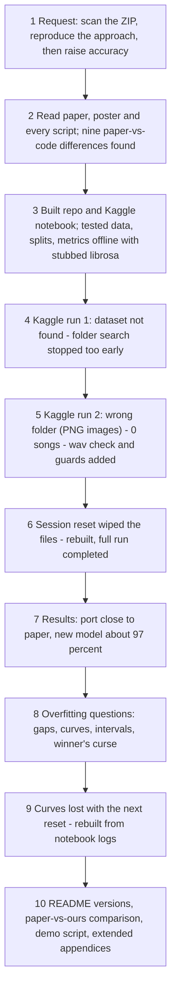

| Step | What happened | Outcome |
|---|---|---|
| 1 | You uploaded the original repo (ZIP), the paper and the poster and asked for an exact reproduction (Kaggle + GitHub folder) and then a more accurate model. | Scope: Objective 1 (reproduce) and Objective 2 (improve). |
| 2 | I unpacked the ZIP, read every script, checked the CSV shapes, compared code with paper. | Findings of §4: leakage, pooling, loss weights, dropout, ReLU decoder, no true test set, TF1. |
| 3 | I ported the models to Keras and wrote the new pipeline, tuner, tests and a notebook generator. The sandbox had no TensorFlow, librosa or data, so only data, splits and metrics could be tested. | Repo + notebook, training code untested on real data. |
| 4 | **Bug 1** (your screenshots, 18 Oct): `GTZAN not found` although the dataset was attached; the folder search pruned directories deeper than five levels before testing them. | Search rewritten: test first, no depth limit. |
| 5 | **Bug 2:** root found as `Data/images_original` (PNG spectrograms) → `0 songs → 0 segments`, then `zero-size array` and `Invalid input shape (512,)`. | A root must contain `.wav` files; loaders raise on zero files and ignore empty caches. |
| 6 | **Session reset:** `/kaggle/working` wiped, patch cell failed with `No such file … utils.py`. | Rerun setup and every `%writefile` cell. The full run then completed. |
| 7 | You shared the executed notebook. | Reproduction within a few points of the paper; honest song split 60.1 %; mel-CNN 97.0 % (98.3 % per song); tuning no gain. |
| 8 | You asked how to know about overfitting. | Gap table, learning curves, intervals, winner’s-curse analysis (§11). |
| 9 | `curves.png` was gone after another reset. | Curves rebuilt from the epoch logs stored in the notebook (`docs/learning_curves_from_log.png`). |
| 10 | README rewritten with diagrams, paper-vs-ours, overfitting; demo script `04_demo.py`; Appendices A–Q; now R–Z. | Current state. |

**Corrections made along the way** (recorded because they matter for honesty): the first README expected leakage to lower the old model’s score noticeably — measured, it did not (61.2 % vs 60.1 %); the hypothesis that tuning would help was not supported; the tuner used to print test scores per trial (never used for selection) and no longer evaluates them.

---

## S. Evidence ledger: what is proven and what is not

| Claim | Status | Evidence |
|---|---|---|
| The original split leaks songs | **[measured]** | Log: 100.0 % of test segments’ songs also appear in train |
| The song split has no leakage | **[measured]** | Log: 0.0 % |
| Our port reproduces the paper’s dev/test level and per-class pattern | **[measured]** | §10.1: 61.2 % vs 65.3 % test; classical F1 0.782 vs 0.779 |
| Leakage barely changed the old model (61.2 → 60.1 %) | **[measured]** | §10.1 vs §10.2 |
| The new model reaches ≈ 97 % on unseen songs | **[measured]**, one run, 60 songs | §10.3 |
| The new model overfits only mildly | **[measured]** | Gap ≈ 3 pts; validation flat (§11.2–11.3) |
| The old approach overfits heavily | **[measured]** | 86.5 % train vs 60.1 % test |
| New ≫ old by ≈ 37 points | **[measured]**, intervals do not overlap | Appendix N, §12.2 |
| Tuning gave no gain | **[measured]** | 95.4 % tuned vs 97.0 % untuned |
| The tuned validation 100 % is a selection effect | **[calculated]** | Trial scores 0.968 ± 0.022 (Appendix I) |
| Reconstruction branch does not raise accuracy | **[measured]**, within noise | 97.0 vs 96.7 % |
| Conv-model parameter counts | **[calculated]** by hand | Appendix D |
| Pooling to 551 Hz is the main accuracy limit | **[reasoned]** | Supported by metal flipping worst → best; no ablation yet |
| The old model cannot exploit leakage because its input is too coarse | **[reasoned]** | §12.4 |
| Early-epoch validation swings are BatchNorm warm-up | **[reasoned]** | Typical cause; not isolated |
| GTZAN has duplicates / mislabels / shared artists | **literature**, not re-verified here | – |
| Why our training accuracy (86 %) is below the paper’s (95 %) | **open** | – |
| Shuffled-label test; 5-fold CV; four ablations | **[not yet run]** | §11.6, §12.5 |
| `04_demo.py` with real weights | **[not yet run]**; logic tested with a stub model | Appendix L |

Rule used in this document: **a number is only called a result if it appears in the Kaggle log.** Everything else is labelled.

---

## T. Why each default value: hyper-parameter rationale

Honest summary: the values below the first block are conventional starting points. **Only the ones in the “Tuner explored” column were searched**; the rest were never tuned.

| Parameter | Value | Origin | Reason | Tuner explored | How to change |
|---|---|---|---|---|---|
| Learning rate (paper) | 1e-4 | original code | fidelity | – | `01 … ` (fixed in code) |
| Batch size (paper) | 512 | original code | fidelity | – | `--batch` |
| Epochs (paper) | 200 / 400 (vanilla AE) | original code | fidelity | – | `--epochs`, `--ae-epochs` |
| Dropout (paper) | rate 0.2 (keep 0.8) | original code | fidelity | – | `build_dsae(dropout=)` |
| Classification weight (paper) | 0.1 | original code | fidelity | – | `--cls-weight` |
| Learning rate (new) | 1e-3 | my default | usual Adam value when BatchNorm is present | 3e-4 … 3e-3 | `--lr` |
| Batch size (new) | 64 | my default | small data; moderately noisy gradients help | 32 / 64 / 128 | `--batch` |
| Base filters | 32 | my default | 0.59 M-parameter CNN, fast on a T4 | 16 / 32 / 48 | `--base` |
| Latent size | 64 | same as the paper | embeddings stay comparable | 32 / 64 / 128 | `--latent` |
| Dropout | 0.3 (blocks 0.15) | my default | 279 training songs overfit easily | 0.1 … 0.5 | `--dropout` |
| Loss weights (conv DSAE) | 1.0 / 1.0 | my default | standardised inputs make MSE and CE similar in scale | cls 0.1 … 5 | `--recon-weight`, `--cls-weight` |
| SpecAugment widths | ≤ 10 bands, ≤ 16 frames | my default | ≈ 16 % of mel axis, 12.5 % of time axis; common range | on/off only | `--no-augment` |
| Early-stop patience | 12 (8 in trials) | my default | rides out noisy 60-song validation | – | `--patience` |
| LR plateau | ×0.5 after 4 epochs, floor 1e-6 | my default | standard schedule | – | `fit_model(lr_patience=)` |
| Epoch cap | 60 (30 in trials, 80 final) | my default | early stopping ended runs at 37–46 | – | `--epochs` |
| Window / hop | 3 s / 1.5 s | my default | rhythm and texture need context; ≈ 19 samples per song | – | `data_mel.py` constants |
| Mel settings | 64 bands, n_fft 1024, hop 512, fmin 20 Hz, top_db 80 | my default | common values; 128 frames fit four 2× poolings | – | `data_mel.py` constants (delete cache afterwards) |
| Split | 70 / 15 / 15 by song, stratified | my default | 60 songs each for validation and test | – | `song_split(val_frac, test_frac)` |
| Seed | 42 | convention | reproducibility | – | `--seed` |
| Tuner budget | 20 trials × ≤ 30 epochs | my default | ≈ 1.5 h on a T4 | – | `--trials`, `--epochs` |

If you change any `data_mel.py` constant, delete `outputs/cache/mel64x128.npz`, otherwise old features are silently reused.

---

## U. Worked examples (all arithmetic checked by script)

**U.1 Average pooling** (pool 4 instead of 40 to keep it small). Samples `[0.2, 0.4, 0.0, -0.2, 0.1, 0.1, 0.3, 0.5]` → means of blocks of four → `[0.1, 0.25]`. The real pipeline does this with blocks of 40, so 20 000 raw samples become 500 values, and everything faster than the block average (above ≈ 276 Hz) disappears.

**U.2 Softmax and cross-entropy.** Logits `[2.0, 0.5, -1.0, 0.0]`, true class 0:
exponentials `[7.389, 1.649, 0.368, 1.000]`, sum `10.406`, probabilities `[0.710, 0.158, 0.035, 0.096]`, loss = −ln(0.710) = **0.342**. If the model were certain and right the loss would approach 0; a 25 % guess gives −ln(0.25) = 1.386.

**U.3 Reconstruction and joint loss.** Input `[0.1, -0.2, 0.3, 0.0]`, reconstruction `[0.0, 0.0, 0.2, 0.1]`: squared errors `[0.01, 0.04, 0.01, 0.01]`, mean = **0.0175**. Joint losses with the cross-entropy above (0.342):

| Model | Formula | Value |
|---|---|---|
| Paper approach | 1.0 · MSE + 0.1 · CE | 0.052 |
| Conv DSAE default | 1.0 · MSE + 1.0 · CE | 0.360 |
| Conv DSAE tuned | 1.0 · MSE + 3.999 · CE | 1.387 |

Note how the weights decide which term dominates: with 0.1 the paper’s loss is mostly reconstruction; with 4.0 the tuned loss is mostly classification. **ReLU-decoder limitation:** the target −0.2 can never be matched by a ReLU output (≥ 0), so that element contributes at least 0.04 to the squared error whatever the network does.

**U.4 From windows to a song.** Five windows of one song, probabilities (classical, jazz, metal, pop), *illustrative numbers, not measured*:

| Window | Classical | Jazz | Metal | Pop | Window’s own guess |
|---|---|---|---|---|---|
| 1 | 0.80 | 0.15 | 0.02 | 0.03 | classical |
| 2 | 0.70 | 0.20 | 0.05 | 0.05 | classical |
| 3 | 0.20 | 0.65 | 0.05 | 0.10 | **jazz** |
| 4 | 0.60 | 0.30 | 0.05 | 0.05 | classical |
| 5 | 0.30 | 0.55 | 0.05 | 0.10 | **jazz** |
| **Mean** | **0.52** | 0.37 | 0.044 | 0.066 | **classical** |

Two of five windows are wrong, yet the song is right and the confidence is 52%. This is why song accuracy (98.3 %) can exceed segment accuracy (97.0 %).

**U.5 Wilson interval for 59 of 60 songs** (z = 1.96): p̂ = 0.9833; z²/2n = 0.03201; z²/4n² + p̂(1−p̂)/n = 0.000540, whose square root times z = 0.04554; denominator 1 + z²/n = 1.06403. Interval = (0.9833 + 0.03201 ∓ 0.04554) / 1.06403 = **0.9114 – 0.9971**, i.e. 91.1 – 99.7 %.

**U.6 Frames and windows.** Window 3 s = 66 150 samples; frames = 1 + ⌊66 150 / 512⌋ = **130** → cropped to 128 (a power of two: four 2× poolings give 128 → 64 → 32 → 16 → 8, so the 4 × 8 map after the encoder upsamples back to exactly 64 × 128). A 661 500-sample clip with window 66 150 and hop 33 075 gives ⌊(661 500 − 66 150) / 33 075⌋ + 1 = **19** windows; slightly shorter clips give 18, which is why 399 songs give 7 579 and not 7 581 windows.

**U.7 One block’s parameters.** Conv 3×3, 1 → 32 channels, no bias: 9 × 1 × 32 = 288; BatchNorm 4 × 32 = 128; Conv 32 → 32: 9 × 32 × 32 = 9 216; BatchNorm 128; total **9 760** (the first row of the shape table in Appendix D).

---

## V. File formats and schemas

| File | Produced by | Contents |
|---|---|---|
| `outputs/cache/paper_500d.npz` | 01, 03 (`paper_dsae`) | `X` float32 (N, 500), `y` int32, `song` int32, `names` (file names, index = song id) |
| `outputs/cache/mel64x128.npz` | 02, 03, 04 | `X` float32 (N, 64, 128) — channel axis and standardisation are added later in `prepare_mel`; `y`, `song`, `names` as above |
| `outputs/<run>/metrics.json` (02) | `02_train_improved.py` | `model`, `params{lr, base, latent, dropout[, cls_weight, recon_weight]}`, `batch`, `spec_aug`, `fold`, `folds`, `val{…}`, `test{…}` |
| result block `val` / `test` | `evaluate.summarize` | `segment_acc`, `segment_macro_f1`, `song_acc`, `n_segments`, `n_songs`, `per_class{genre → precision, recall, f1-score}` |
| `outputs/<run>/metrics.json` (01) | `01_reproduce_paper.py` | `table1{two_layer_nn, deep_softmax_ae → train, dev, test}`, `table2_dsae_test{…}` |
| `outputs/tune/best_params.json` | 03 | flat dict of the best trial: `lr`, `base`, `latent`, `dropout`, (`cls_weight`), `batch`, `spec_aug` |
| `outputs/tune/trials.csv` | 03 | Optuna’s trial table: trial number, value (validation song accuracy), start/finish/duration, one `params_*` column per parameter, `user_attrs_val_segment_acc`, state (column set is Optuna’s; check the header) |
| `outputs/tune/final_metrics.json` | 03 | `best_params`, `val`, `test` of the longer retrain |
| `outputs/<run>/<model>.weights.h5` | 02 | Keras **weights only** — no architecture, no optimiser, **no normalisation statistics** |
| `outputs/demo/demo_<name>.png` | 04 | spectrogram of the first window + probability bars |
| `/kaggle/working/genre_outputs.zip` | notebook | zip of all of `outputs/` |

Important consequence: the training mean and standard deviation are **not** inside the weights file. `04_demo.py` recomputes them by rebuilding the same song split (seed 42) from the cached features. If you ever use the model outside this repository, save `μ` and `σ` yourself.

---

## W. From audio file to genre: the inference path and what can go wrong

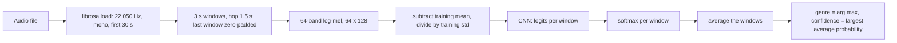

| Situation | What happens | Advice |
|---|---|---|
| Clip shorter than 3 s | One zero-padded window | Prediction is weak; use ≥ 10 s |
| Clip longer than 30 s | Only the first 30 s are read | Cut the interesting part first |
| Stereo / other sample rate | Converted to mono at 22 050 Hz by librosa | Fine |
| Very quiet or very loud recording | Features keep absolute level (`ref=1.0`), so level changes shift the input | Normalise gain if results look odd |
| Phone recording, noise, speech, a genre outside the four | The softmax must still pick one of the four | Confidence is **not** a guarantee; an out-of-distribution input can give a confident wrong answer |
| mp3 / other formats | Depends on codecs available to librosa | Convert to `.wav` |
| Weights from a different configuration | `load_weights` shape mismatch | The demo builds the **default** CNN (base 32, latent 64); use weights from `--model cnn` with defaults |
| Normalisation statistics missing | Wrong scale → nonsense | Keep the feature cache or save μ, σ |

Mode differences to remember: during training Keras logs accuracy with dropout and masks **on**; validation, the demo and script 01’s train/dev/test accuracy are in inference mode.

---

## X. Publishing: GitHub and Kaggle, step by step

### X.1 GitHub
```bash
cd genre-extraction-repro
git init
git add .
git commit -m "Genre extraction: reproduction, honest evaluation, mel-CNN"
git branch -M main
git remote add origin https://github.com/<your-user>/<repo>.git
git push -u origin main
```
* `.gitignore` already excludes `outputs/`, `cache/`, `*.weights.h5`, `*.npz`, notebooks’ checkpoints and Python caches. Do **not** commit audio or the GTZAN dataset.
* `docs/learning_curves_from_log.png` is committed and referenced by relative path, so it renders in the README.
* Mermaid diagrams render natively on GitHub; the ASCII versions cover other viewers.
* The repository contains **no licence file**; add one of your choosing. The original authors’ repository has no licence either, which is why none of their code is copied (see §18).
* To share trained weights, attach them to a GitHub **Release** or put them in a Kaggle Dataset rather than in git history.

### X.2 Kaggle: keeping your results
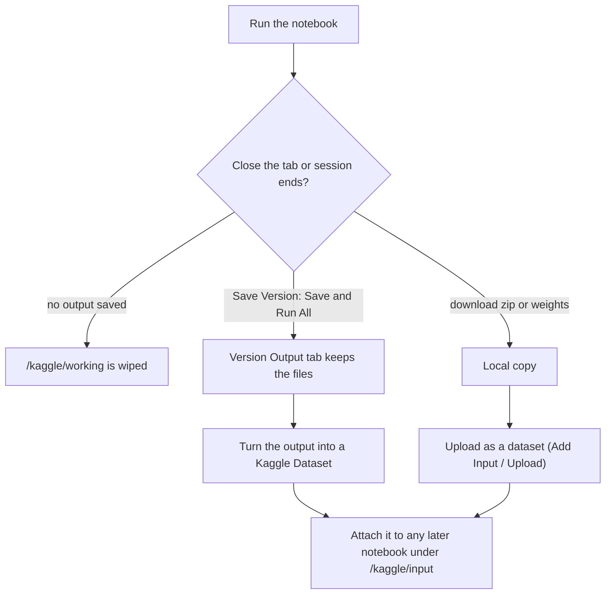
1. Before committing, remove or skip the tuning cells (≈ 1.5 h) — they gave no gain. “Save & Run All” re-executes the notebook top to bottom in a fresh session (check the Save Version dialog for the current wording and limits).
2. After the run, download `genre_outputs.zip` and `outputs/cnn/cnn.weights.h5` from the Output panel.
3. To avoid retraining in a future demo: upload `cnn.weights.h5` and `mel64x128.npz` as a dataset, attach it, find the paths with `!find /kaggle/input -name "cnn.weights.h5"`, then run  
   `python scripts/04_demo.py --weights <path>/cnn.weights.h5 --cache <path>/mel64x128.npz --n 12`  
   (the dataset’s mount path differs from `/kaggle/working`; use what `find` prints).
4. Check your account’s GPU quota before long runs.

---

## Y. Presentation script (7 minutes) and hand-in checklist


| Time | What to say | What to show |
|---|---|---|
| 0:00–0:45 | Genre classification from raw audio; the paper learns a 64-number embedding with an autoencoder plus classifier. | §2 diagram |
| 0:45–1:45 | Two problems: segments of one song sat in both train and test; pooling by 40 leaves only content below ≈ 276 Hz. On an honest split the paper’s approach scores ≈ 60 % and overfits by ≈ 26 points. | §4 leakage picture, §10.2 |
| 1:45–3:00 | We split by song, switched to log-mel spectrograms, used a CNN (and a convolutional autoencoder that keeps the embedding), with dropout, SpecAugment and early stopping. | §7 diagrams |
| 3:00–4:15 | 97.0 % per segment, 98.3 % per song on 60 unseen songs; paper approach 60.1 %. | §0 / §12.2 tables |
| 4:15–5:15 | Train ≈ 99.9 %, test ≈ 97 %; validation flat; no song shared. Mild, harmless overfitting. | `learning_curves_from_log.png`, §11.2 |
| 5:15–6:30 | Run `04_demo.py`: recomputed test accuracy equals the saved value; list songs; classify your own clip. | notebook §7 cells |
| 6:30–7:00 | Limits: 60 songs (≈ 89–99 %), GTZAN flaws, tuning did not help; pending: shuffled-label test, 5-fold CV, ablations. | Appendix S |

**If something fails:** wrong song → “expected, about 1 in 60”; own clip wrong → four-genre model, 30 s GTZAN style, confidence ≠ correctness (Appendix W); weights missing → show the saved figures and tables, say the run is reproducible in ≈ 5 minutes once features are cached.

**Where to find answers fast**

| Question | Section |
|---|---|
| Did it overfit? | §11, §16 |
| Why is it better than the paper? | §12, Appendix S |
| Why split by song? | §4, §7-A |
| How reliable is 97 %? | Appendix N, U.5 |
| What did tuning do? | §9.3, Appendix I |
| What is not proven? | Appendix S |
| How do I rerun it? | §13, Appendix X |

**Hand-in checklist**
- [ ] README (this file), repo ZIP or GitHub link
- [ ] `learning_curves_from_log.png`, and if available the new `curves.png`, `confusion_test.png`, `pca_embedding_test.png`
- [ ] `cnn.weights.h5` and `mel64x128.npz` saved somewhere that survives a Kaggle reset
- [ ] One-sentence answer on overfitting (§16) and the three honest limits
- [ ] Demo rehearsed once from a fresh session
- [ ] Original authors credited (§18)

---

## Z. Extra glossary and diagram index

### Z.1 Extra glossary (terms not defined in §17 or Appendix P)

| Term | Meaning |
|---|---|
| **Mel filterbank** | A set of triangular filters, spaced on the mel scale, that sum FFT bins into 64 perceptual frequency bands. |
| **Standardisation (z-score)** | Subtract the mean and divide by the standard deviation so values are centred on 0 with unit spread; here with training-set statistics. |
| **Learning rate** | Size of each weight update; too large is unstable, too small is slow. |
| **Adam** | Optimiser that adapts the step size per parameter using running averages of gradients. |
| **Glorot (Xavier) initialisation** | Random starting weights scaled so signals neither shrink nor blow up from layer to layer; the Keras default. |
| **One-hot** | A label stored as a vector with a single 1 (e.g. metal = `[0, 0, 1, 0]`). |
| **Receptive field** | The part of the input one unit can “see”; it grows with depth. |
| **Upsampling** | Doubling a feature map’s height and width so a decoder can rebuild resolution. |
| **Inference mode vs training mode** | Whether dropout and augmentation are active (training) or off (evaluation). |
| **Cache** | Saved intermediate arrays (`.npz`) so slow steps such as audio reading run only once. |
| **Baseline** | A simple reference model new results are compared against (here the two-layer NN and the old DSAE). |
| **Validation set vs test set** | Validation guides choices (epochs, settings); the test set is looked at once for the final score. |
| **Macro average** | Unweighted mean over classes; equals the weighted mean here because all classes have equal support. |
| **Study / trial (Optuna)** | The whole search / one parameter set evaluated within it. |
| **Segment, window, song** | Old pipeline: ≈ 0.9 s *segment*; new pipeline: 3 s *window*; a *song* is one 30 s clip made of many of them. Splits are done on songs. |
| **Calibration / confidence** | Whether a stated probability matches how often the model is right; a high confidence is not proof of correctness. |
| **Domain shift** | Test data that differs from training data (other recording conditions or genres); accuracy can drop sharply. |
| **top_db** | Dynamic-range limit in `power_to_db`: values more than 80 dB below the window’s peak are clipped. |

### Z.2 Diagram index
| # | Section | Diagram type |
|---|---|---|
| 1 | 1. Goals | flowchart |
| 2 | 3. What was inside the ZIP (the scan) | flowchart |
| 3 | 5. Overall plan — what I did, in order | flowchart |
| 4 | 6.1 Data pipeline (`src/genre/data_paper.py`) | flowchart |
| 5 | 6.2 The three models (`src/genre/models_paper.py`) | flowchart |
| 6 | 7. Objective 2 — improvement, step by step | flowchart |
| 7 | B. Log-mel input (`data_mel.py`) | flowchart |
| 8 | D. Conv Deep Softmax Autoencoder (`build_conv_dsae`) — **1 556 965 parameters** (default), 392 557 (tuned), same caveat | flowchart |
| 9 | 9.1 Method (`scripts/03_tune_optuna.py`) | flowchart |
| 10 | 11.1 What overfitting is | flowchart |
| 11 | 12.1 Side by side | flowchart |
| 12 | 14. Development log: what broke and why | flowchart |
| 13 | A. Code map: every file, function and flag | flowchart |
| 14 | B. Data shapes and sizes through both pipelines | flowchart |
| 15 | F. A training run, step by step | sequenceDiagram |
| 16 | R. Project chronicle: what happened, in order | flowchart |
| 17 | W. From audio file to genre: the inference path and what can go wrong | flowchart |
| 18 | X.2 Kaggle: keeping your results | flowchart |
| 19 | Y. Presentation script (7 minutes) and hand-in checklist | flowchart |

---

## 18. Attribution
Reimplementation of the architecture and protocol of Sawhney, Vasavada & Wang (2018); original code at
<https://github.com/arjunsawknee/Genre-Extraction> (no licence file was included in the archive, so none of its code is redistributed here).
Dataset: GTZAN (Tzanetakis & Cook, 2002). Please credit both if you publish results.
