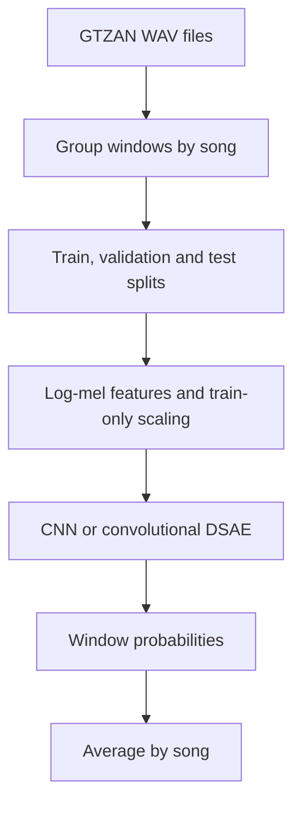
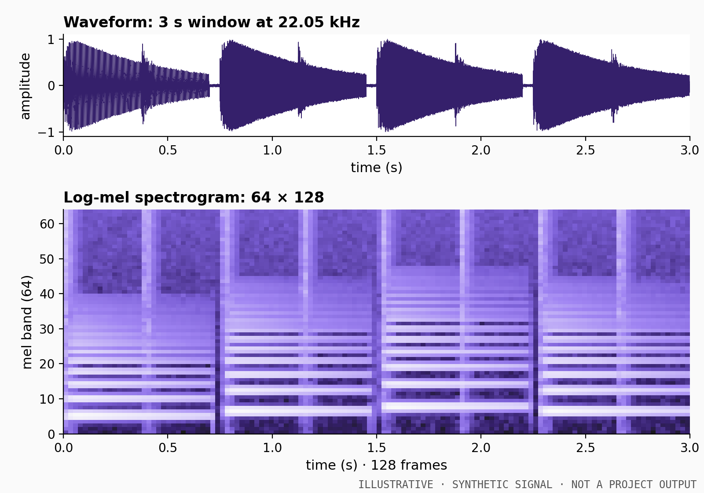

# Latent Feature Extraction for Musical Genres

A TensorFlow/Keras reproduction of the Stanford CS229 genre-classification project by Sawhney, Vasavada and Wang (2018). It compares a waveform-based Deep Softmax Autoencoder (DSAE) with a log-mel CNN and a convolutional DSAE on four GTZAN genres: classical, jazz, metal and pop.

## How it works

The original approach average-pools the waveform into 500-value segments. The improved pipeline extracts 64 × 128 log-mel spectrograms and assigns every window from a song to the same split. The CNN learns a 64-dimensional embedding and predicts a genre for each window. Averaging window probabilities gives the song-level prediction.





## Results

| Model and evaluation split | Segment accuracy | Song accuracy |
| --- | ---: | ---: |
| Original paper DSAE, reported segment split | 65.3% | — |
| Reproduced DSAE, random segment split | 61.2% | — |
| Reproduced DSAE, song split | 60.1% | 65.0% |
| Mel-CNN, song split | **97.0%** | **98.3%** |
| Convolutional DSAE, song split | 96.7% | 96.7% |

The reproduction results come from a single Kaggle run with seed 42. The mel-CNN classified 59 of 60 held-out songs correctly, with a segment macro-F1 of 0.970 and a train–test accuracy gap of about 3 percentage points. Tuning did not improve the reported result. Cross-validation and the shuffled-label check remain pending.


## Run locally

From the repository root, use a Python environment with the [project dependencies](requirements.txt). Set `--data-root` to the GTZAN WAV directory containing `classical/`, `jazz/`, `metal/` and `pop/`.

```bash
python -m pip install -r requirements.txt
python tests/test_pipeline.py
python scripts/02_train_improved.py --data-root "/path/to/genres_original" --model cnn --out outputs/cnn
python scripts/04_demo.py --weights outputs/cnn/cnn.weights.h5 --cache outputs/cache/mel64x128.npz --n 12
```

The smoke test uses synthetic data. See [scripts](scripts/README.md) for the reproduction, alternative model, tuning and custom-audio commands.

## Run on Kaggle

Import the [training notebook](notebooks/kaggle_genre_extraction.ipynb), attach GTZAN with the original WAV files, enable a GPU and run from the first cell. Save or download the outputs before ending the session. The [demo notebook](notebooks/kaggle_demo_only.ipynb) uses the saved CNN weights and feature cache.

## Repository guide

| Folder | Purpose |
| --- | --- |
| [`docs/`](docs/README.md) | Figures and detailed project notes |
| [`notebooks/`](notebooks/README.md) | Kaggle training and demo workflows |
| [`scripts/`](scripts/README.md) | Training, tuning and inference commands |
| [`src/`](src/README.md) and [`src/genre/`](src/genre/README.md) | Data, models, training and evaluation code |
| [`tests/`](tests/README.md) | Offline pipeline smoke test |
| [`tools/`](tools/README.md) | Notebook generators |

The [detailed project notes](docs/project-notes.md) preserve the original diagrams, experiment settings, per-class results and overfitting analysis.

## Credits

Based on [Latent Feature Extraction for Musical Genres from Raw Audio](https://github.com/arjunsawknee/Genre-Extraction) by Sawhney, Vasavada and Wang. Dataset by Tzanetakis and Cook (GTZAN).
